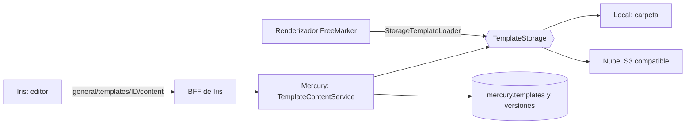

# Análisis: editor de plantillas y gestión de campañas

> Estado: **propuesta para aprobar** · Fecha: 2026-11-04 · Repos: `iris` (UI + BFF) y `mercury` (backend)
> Nada de esto está implementado. Al final, la sección 9 lista las decisiones que hay que confirmar antes de empezar.

## 1. Objetivo

1. Que una persona autorizada **cree y edite plantillas** de mensajes desde Iris, con un editor en **HTML o Markdown** y vista previa.
2. Que el **contenido** de las plantillas (hoy archivos FreeMarker `.ftl`) se lea de una **ruta gestionada por Mercury**, que puede ser **local o en la nube**.
3. Que Iris permita **gestionar campañas**: listar, ver, crear, editar, pausar/reanudar, eliminar y seguir su progreso.

## 2. Situación actual (verificada en el código)

### Plantillas

| Hecho | Dónde |
|---|---|
| `mercury.templates` guarda solo **metadatos**: `description`, `location` (puntero de hasta 500 caracteres), `file_format`, tipo, severidad, aplicación, `active`. | `TemplateEntity`, `docs/template-management-api.md` |
| El contenido real son archivos `.ftl` en una carpeta local (`TEMPLATE_PATH`, por defecto `/usr/local/runme/templates`), horneados en la imagen o montados con `MERCURY_TEMPLATES_HOST_PATH`. | `FreeMarkerConfig`, `application.yml` |
| `FreeMarkerConfig` usa `setDirectoryForTemplateLoading(File)`: **solo disco local**, sin nube. | `FreeMarkerConfig.java` |
| El correo, Telegram y los demás canales resuelven la plantilla por `template.location` (nombre de archivo) y la renderizan con FreeMarker. | `ChannelTemplateRenderer`, `TelegramTemplateRenderer`, `EmailServiceImpl` |
| La API de plantillas ya existe: crear, actualizar, desactivar, obtener, buscar. Exige `Authorization: Bearer` + `session-token` y el permiso `TEMPLATE_MANAGE` en Backbone por aplicación. | `TemplateController` |
| **No hay** API para leer ni escribir el contenido. | — |
| **No hay** listados de tipos de plantilla, severidades ni plantillas definidas (`template_defined`). Una campaña referencia una `template_defined`, no una `template`. | OpenAPI, `CampaignServiceImpl` |
| Hay plantillas del sistema (`zb_*`, `iris_verification_*`, `sk_*`) cuyo nombre y parámetros son un **contrato con otros servicios**. Si se editan mal, se rompe el envío. | `docs/zerobound-mail-templates.md` |

### Campañas

| Hecho | Dónde |
|---|---|
| Endpoints existentes: `POST /campaigns`, `GET /campaigns/{id}`, `GET /campaigns/application/{appId}`, `PUT /campaigns/{id}`, `PATCH /campaigns/{id}/toggle?enabled=`, `DELETE /campaigns/{id}`, `GET /campaigns/{id}/progress`, `GET /channel-types`. | `CampaignController`, `openapi.yaml` |
| Crear exige `userId` igual al de la sesión. Editar, pausar y eliminar solo los puede hacer **el creador** (`createdBy`); si no, 403. | `CampaignController`, `CampaignServiceImpl` |
| Activar una campaña sin plantilla da 422. Las campañas llevan columnas de borrado lógico (migración V2027). | `docs/toggle-campaign.md` |
| Iris ya consume `GET /campaigns/application/{id}` y `/progress` para el dashboard. | `monitoring.routes.js` |
| El proxy `/mrc/api/v1/general/*` ya reenvía a Mercury con la sesión de la persona: **para campañas el BFF no necesita rutas nuevas**. | `mercury.routes.js` |

## 3. Brechas

| # | Brecha | Consecuencia |
|---|---|---|
| B1 | Mercury no guarda ni expone el contenido de las plantillas. | Sin backend no hay editor. |
| B2 | El cargador de FreeMarker solo lee disco local. | La nube no es posible sin cambiar `FreeMarkerConfig`. |
| B3 | Sin listados de tipos, severidades ni plantillas definidas. | Los formularios obligarían a escribir UUID. |
| B4 | Editar FreeMarker equivale a ejecutar código en el servidor si no se restringe el motor (`?new`, `Execute`, `ObjectConstructor`, API builtins). | Riesgo de ejecución remota de código. Bloqueante. |
| B5 | Una plantilla del sistema editada sin cuidado rompe a otros servicios. | Hay que protegerlas. |
| B6 | Una campaña solo la puede tocar su creador. | La gestión por otro administrador da 403. Decisión de producto. |

## 4. Requisitos funcionales

### Plantillas (RF-T)

| ID | Requisito | Prioridad |
|---|---|:---:|
| RF-T1 | Listar plantillas de la aplicación con búsqueda por texto, tipo y severidad, y paginación. | Must |
| RF-T2 | Ver una plantilla: metadatos y contenido. | Must |
| RF-T3 | Crear una plantilla: metadatos y contenido, en editor **HTML** o **Markdown**. | Must |
| RF-T4 | Editar metadatos y contenido de una plantilla existente. | Must |
| RF-T5 | Desactivar una plantilla (borrado lógico), con confirmación y aviso si alguna campaña activa la usa. | Must |
| RF-T6 | **Vista previa** renderizada con parámetros de ejemplo, en un recuadro aislado (`sandbox`), sin enviar nada. | Must |
| RF-T7 | **Validación** al guardar: sintaxis FreeMarker, tamaño máximo, nombre de archivo válido; los errores indican línea y columna. | Must |
| RF-T8 | Detectar los **parámetros** que usa la plantilla (`${nombre}`) y mostrarlos al crear una campaña. | Should |
| RF-T9 | Plantillas del sistema marcadas como **protegidas**: solo lectura, o edición con confirmación reforzada y copia previa. | Must |
| RF-T10 | Historial de versiones y restauración de la anterior. | Should |
| RF-T11 | Duplicar una plantilla como punto de partida. | Could |
| RF-T12 | Idiomas: una plantilla por idioma (`_es`, `_en`) con selector. | Should |
| RF-T13 | Enviar un correo de prueba a la propia persona. | Could |

### Campañas (RF-C)

| ID | Requisito | Prioridad |
|---|---|:---:|
| RF-C1 | Listar campañas de la aplicación con estado, canal, progreso y filtros (estado, canal, texto, fechas) y paginación. | Must |
| RF-C2 | Ver el detalle de una campaña y su progreso (enviados, entregados, fallidos, pendientes, aperturas), con refresco. | Must |
| RF-C3 | Crear una campaña: nombre, canal, plantilla, destinatarios, parámetros y programación. | Must |
| RF-C4 | Cargar destinatarios pegando una lista o importando un CSV (identificador, nombre, parámetros), con validación y deduplicación. | Must |
| RF-C5 | Editar una campaña que aún no ha empezado (nombre, plantilla, destinatarios, parámetros, programación). | Must |
| RF-C6 | Pausar y reanudar una campaña. | Must |
| RF-C7 | Eliminar una campaña, con confirmación. | Must |
| RF-C8 | Guardar como borrador y programar el envío en fecha y hora. | Should |
| RF-C9 | Vista previa del mensaje con los parámetros de un destinatario. | Should |
| RF-C10 | Mostrar al usuario cuando una acción no está permitida (403 por no ser el creador) y por qué. | Must |

## 5. Requisitos no funcionales

| ID | Requisito |
|---|---|
| RNF-1 **Seguridad del motor** | Configurar FreeMarker con `TemplateClassResolver.ALLOWS_NOTHING_RESOLVER`, `setAPIBuiltinEnabled(false)` y sin acceso a clases arbitrarias antes de permitir edición. Pruebas con las cargas conocidas de inyección (`?new`, `Execute`, `ObjectConstructor`). |
| RNF-2 **Autorización** | Leer/editar plantillas exige `TEMPLATE_MANAGE` por aplicación (Backbone). Un permiso de solo lectura puede ver sin editar. Fallo cerrado ante cualquier error del servicio de permisos. |
| RNF-3 **Entrada** | Nombres de archivo con lista blanca (`[a-z0-9._-]`, sin `/`, `..` ni barras invertidas). Tamaño máximo (p. ej. 256 KB). Contenido y parámetros nunca aparecen en logs. |
| RNF-4 **Vista previa segura** | HTML mostrado en `iframe sandbox` sin scripts, con CSP; el Markdown se convierte con saneado (sin HTML crudo peligroso). |
| RNF-5 **Almacenamiento** | Una abstracción única (`TemplateStorage`) con proveedor **local** (carpeta) y **nube** (S3 compatible como primera opción), elegida por configuración. Escrituras atómicas; nunca un archivo a medias. |
| RNF-6 **Consistencia** | Todas las instancias de Mercury ven el mismo contenido: en nube, lectura del almacén con caché corta e invalidación al guardar. En local multi-réplica, volumen compartido o solo nube. |
| RNF-7 **Rendimiento** | Listado y lectura < 500 ms p95; guardado con validación < 2 s; vista previa < 1 s. |
| RNF-8 **Compatibilidad** | Las plantillas existentes y su `location` siguen funcionando sin migrar el contenido a mano. Los consumidores (ZeroBound, SmartKin, Iris) no cambian. |
| RNF-9 **Auditoría** | Registrar quién creó, editó o desactivó una plantilla y cuándo (id, no contenido). |
| RNF-10 **Calidad** | Cobertura ≥ 85 % en Iris (frontend y BFF) y las pruebas de Mercury del módulo; pruebas de integración del almacén local y del de nube (emulador). |
| RNF-11 **Accesibilidad y UX** | WCAG AA, teclado completo, tema claro/oscuro/sistema, mensajes en español. |
| RNF-12 **Operación** | Configuración no confidencial en `config/local.env`; credenciales del almacén solo en `secrets`/Vault. `docker-compose` y `k8s` actualizados. |

## 6. Diseño propuesto

### 6.1 Contenido en Mercury

- **`TemplateStorage`** (interfaz): `read(name)`, `write(name, bytes, expectedEtag)`, `delete(name)`, `list(prefix)`, `exists(name)`. Implementaciones `LocalTemplateStorage` y `S3TemplateStorage`. Se elige con `TEMPLATE_STORAGE=local|s3`; `TEMPLATE_PATH` sigue siendo la carpeta local.
- **`StorageTemplateLoader`**: un `TemplateLoader` de FreeMarker que lee de `TemplateStorage`. Sustituye a `setDirectoryForTemplateLoading`, de modo que el correo, Telegram y los demás canales usan el contenido editado sin cambios.
- **Sin migración de contenido:** `location` seguirá siendo el nombre del archivo. En local, los `.ftl` actuales ya están donde se esperan.
- **Versiones:** tabla `mercury.template_versions(id, template_id, version, content_hash, created_by, created_at, storage_key)` para el historial y la restauración (RF-T10). La versión vigente es la que lee el cargador.
- **Concurrencia:** `ETag`/`If-Match` en el guardado; si alguien editó entretanto, 412 y la UI ofrece comparar.
- **Markdown:** se guarda **el Markdown como fuente** (`file_format=MD`) y Mercury lo compila a HTML+FreeMarker al renderizar (los `${param}` se conservan). Así el editor puede volver a abrir el original. Decisión a confirmar (9.3).

### 6.2 API nueva en Mercury

| Método y ruta | Uso | Permiso |
|---|---|---|
| `GET /api/v1/templates/{id}/content` | Contenido y `ETag`. | `TEMPLATE_MANAGE` (lectura) |
| `PUT /api/v1/templates/{id}/content` | Guarda; `If-Match`; valida sintaxis. | `TEMPLATE_MANAGE` |
| `POST /api/v1/templates/preview` | Renderiza contenido + parámetros de ejemplo, sin guardar. | `TEMPLATE_MANAGE` |
| `GET /api/v1/templates/{id}/versions`, `POST .../versions/{v}/restore` | Historial. | `TEMPLATE_MANAGE` |
| `GET /api/v1/template-types`, `GET /api/v1/severity-types` | Listados para los selectores. | sesión válida |
| `GET /api/v1/template-defined?applicationId=` | Plantillas definidas utilizables por campañas. | sesión válida |
| `GET /api/v1/templates/{id}/parameters` | Parámetros detectados. | `TEMPLATE_MANAGE` |

Las rutas actuales (`POST/PUT/DELETE/GET /templates`) no cambian. `PUT /campaigns/{id}` y demás tampoco.

### 6.3 Iris

- **BFF:** sin rutas nuevas. El proxy ya reenvía `/mrc/api/v1/general/*`. Solo hay que revisar el límite de `express.json` (2 MB, suficiente) y añadir pruebas del paso del `If-Match`/`ETag`.
- **Frontend:** dos páginas nuevas bajo `/dashboard`, con la misma estructura de rutas:
  - `templates` (lista) y `templates/:id` / `templates/new` (editor).
  - `campaigns` (lista, que sustituye a la pantalla "Campañas" actual de `data`), `campaigns/new`, `campaigns/:id`.
- **Editor:** dos paneles (código y vista previa), pestañas HTML/Markdown, barra de parámetros detectados, panel de errores de validación, aviso de cambios sin guardar. Para el editor de código se propone **CodeMirror 6** (ligero, accesible, sin dependencia de servidor); alternativa: `<textarea>` con resaltado mínimo en la primera entrega.
- **Servicios:** `TemplatesService`, `CampaignsService`, modelos tipados, estados de carga/vacío/error (como `login-clients`).
- **Menú:** entradas "Plantillas" y "Campañas" visibles según el permiso.

## 7. Plan de implementación

Cada fase termina con pruebas y es desplegable por sí sola.

| Fase | Contenido | Repo | Estimación |
|---|---|---|---:|
| **0. Decisiones** | Cerrar la sección 9 (almacén en nube, Markdown, permisos, plantillas del sistema). | — | 0,5 d |
| **1. Campañas en Iris** | `CampaignsService`, lista con filtros y progreso, detalle, crear/editar/pausar/eliminar, importar destinatarios. Usa la API actual. Selectores de plantilla provisionales hasta la fase 3. | iris | 5 d |
| **2. Endurecer FreeMarker** | RNF-1: resolver de clases, `apiBuiltinEnabled=false`, pruebas de inyección. Es prerrequisito de cualquier edición. | mercury | 1 d |
| **3. Listados de referencia** | `template-types`, `severity-types`, `template-defined`; selectores en los formularios. | mercury + iris | 1,5 d |
| **4. `TemplateStorage` + cargador** | Interfaz, proveedor local, `StorageTemplateLoader`, configuración, pruebas con las plantillas existentes (regresión de `ZeroboundTemplatesTest`). | mercury | 3 d |
| **5. API de contenido** | `GET/PUT content`, validación de sintaxis, `preview`, `parameters`, `ETag`, protección de plantillas del sistema, auditoría. | mercury | 4 d |
| **6. Editor en Iris** | Lista de plantillas, editor HTML/MD con vista previa aislada, validación, parámetros, conflictos 412. | iris | 6 d |
| **7. Nube** | `S3TemplateStorage`, caché e invalidación, emulador en pruebas, `docker-compose`/`k8s`, secretos. | mercury + infra | 4 d |
| **8. Versiones** | Tabla, historial, restauración, interfaz de comparación. | mercury + iris | 3 d |
| **9. Cierre** | Documentación (`docs/technical`, `docs/user`), `CHANGELOG`, revisión de seguridad, pruebas de carga ligeras. | ambos | 1,5 d |

Total orientativo: **~30 días-persona**. Las fases 1 y 2 no dependen entre sí y pueden avanzar en paralelo; la 6 depende de la 5, y la 7 de la 4.

### Criterios de aceptación globales

- Una persona con `TEMPLATE_MANAGE` crea una plantilla Markdown, la previsualiza, la guarda, la usa en una campaña y el mensaje llega renderizado con ella.
- Las plantillas actuales de ZeroBound/SmartKin/Iris siguen enviando sin cambios.
- Una inyección FreeMarker en el editor es rechazada y queda registrada.
- Con `TEMPLATE_STORAGE=s3` y dos réplicas, una edición se ve en ambas en menos de 10 s.
- Sin el permiso, el editor muestra el motivo y no permite guardar.

## 8. Riesgos

| Riesgo | Impacto | Mitigación |
|---|---|---|
| Ejecución de código por FreeMarker (B4) | Crítico | Fase 2 antes que cualquier edición; revisión de seguridad en la fase 9. |
| Romper plantillas de otros servicios | Alto | Protección de plantillas del sistema, versiones y restauración, prueba de regresión. |
| Réplicas con contenido distinto | Medio | Almacén único en nube o volumen compartido; caché con TTL e invalidación. |
| Cambio de `FreeMarkerConfig` afecta a todos los canales | Medio | Cargador compatible con el actual, activado por configuración, pruebas por canal. |
| Campañas solo editables por el creador | Medio | Decisión de producto 9.4. |
| Alcance de dos repos | Medio | Fases independientes y desplegables; contrato OpenAPI acordado antes de la fase 5. |

## 9. Decisiones pendientes (con propuesta)

| # | Decisión | Propuesta |
|---|---|---|
| 9.1 | ¿Qué nube primero? | S3 compatible (AWS S3 o MinIO), por ser portable; GCS/Azure después, tras la misma interfaz. |
| 9.2 | ¿Dónde se guarda el contenido en local? | La carpeta `TEMPLATE_PATH` actual; con varias réplicas, volumen compartido o nube. |
| 9.3 | ¿Markdown como fuente o convertido a HTML al guardar? | Fuente Markdown, compilada al renderizar (editable después). |
| 9.4 | ¿Quién puede editar/pausar campañas ajenas? | Mantener "solo el creador" en la primera entrega; después, un permiso `CAMPAIGN_MANAGE` por aplicación en Backbone. |
| 9.5 | ¿Plantillas del sistema editables? | Solo lectura por defecto; edición con confirmación y versión previa guardada. |
| 9.6 | ¿Editor de código? | CodeMirror 6. |
| 9.7 | ¿Mercury publica un cliente OpenAPI para generar los modelos de Iris? | No; modelos escritos a mano y verificados contra `openapi.yaml`. |

## 10. Siguiente paso

Si estás de acuerdo con las propuestas de la sección 9, se empieza por la **fase 1** (campañas en Iris, sin tocar Mercury) y por la **fase 2** (endurecer FreeMarker en Mercury), que no dependen de ninguna decisión abierta. Las historias del backlog (`docs/roadmap/F6-…`) y las tareas de YouTrack se generan a partir de la tabla de la sección 7 cuando se apruebe.
