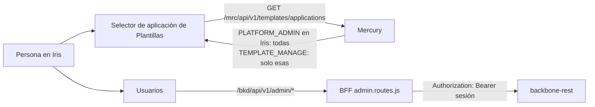

# Administración de usuarios y accesos

Quién puede gestionar plantillas y aplicaciones se define en Backbone; Iris solo lo muestra y lo edita.

## Tipos de persona

| Tipo | Se define en Backbone con | Ve en Iris |
|---|---|---|
| Administrador de la plataforma | Un rol con la feature `PLATFORM_ADMIN` en la aplicación Iris | Todas las aplicaciones, todas las plantillas, los login clients |
| Administrador de plantillas de una o varias aplicaciones | Un rol con `TEMPLATE_MANAGE`/`TEMPLATE_READ` en **cada** aplicación | Solo esas aplicaciones |

El detalle de la autorización está en Mercury (`docs/tec/en/12-platform-administration.md`).

## BFF

`server/routes/admin.routes.js`, montado en `/bkd/api/v1/admin` antes del paso directo a Backbone. Todas las llamadas llevan la sesión como `Authorization: Bearer` (Backbone no lee otra cabecera en estos recursos) y el query del navegador se descarta; Backbone decide con `WRITE_USER`/`READ_USER` y devuelve su 403 tal cual.

| Ruta | Backbone |
|---|---|
| `GET /applications` | `GET /applications` |
| `GET /applications/:id/users` | `GET /users/application/:id` |
| `GET /applications/:id/roles` | `GET /roles/application/:id` |
| `GET /users/:userId/access` | `GET /users/:userId/access` |
| `PUT /users/:userId/access/:applicationId/role/:roleId` | igual (da o cambia el rol en esa aplicación) |
| `DELETE /users/:userId/access/:applicationId` | igual |
| `POST /users` | `POST /users` con solo los campos permitidos; `applicationId` y `roleId` deben ser UUID |

Los ids de la ruta se validan como UUID (400 si no). El selector de Plantillas ya no lee las aplicaciones de Backbone: usa `GET /mrc/api/v1/templates/applications`, que Mercury filtra por persona.

## Frontend

`UsersPageComponent` (`/dashboard/users`, entrada «Usuarios» del menú): elegir aplicación, lista de sus usuarios, «Accesos» por usuario (dar acceso con aplicación y rol, quitar) y «Nuevo usuario». `UserAccessService` habla con el BFF.

## Límites conocidos

- Backbone solo aplica `WRITE_USER`/`READ_USER` si su modo de autorización es `ENFORCE`; en `OFF`/`OBSERVE` cualquier sesión podría llamar a estos recursos. Confirmar el modo en cada entorno.
- No se pudo probar contra un Backbone real: los tests del BFF usan un sustituto que exige el Bearer.
