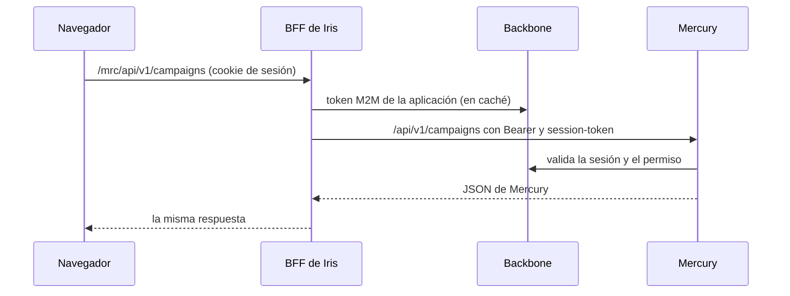
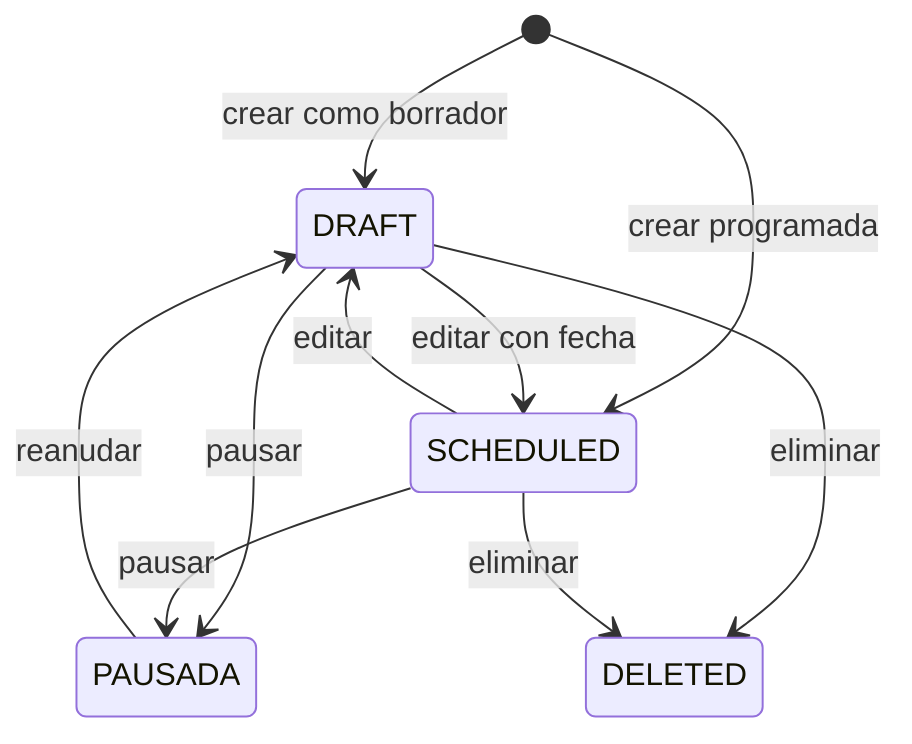

# Gestión de campañas

Iris lista, crea, edita, pausa, reanuda y elimina campañas de Mercury, y muestra su avance. Iris no guarda nada: el BFF reenvía a Mercury con las credenciales de la aplicación y la sesión de la persona.

## Rutas del BFF

| Método y ruta | Mercury | Notas |
|---|---|---|
| `GET /campaigns` | `GET /campaigns/application/{MONITORED_APPLICATION_ID}` | Campañas **creadas por la persona** en la aplicación. |
| `GET /campaigns/channel-types` | `GET /channel-types/enabled` | Canales para el selector. Va antes de `/:id`. |
| `GET /campaigns/:id` | `GET /campaigns/{id}` | |
| `GET /campaigns/:id/progress` | `GET /campaigns/{id}/progress` | |
| `POST /campaigns` | `POST /campaigns` | El BFF fija `applicationId`; solo pasan `name`, `channelTypeCode`, `templateId`, `userId`, `recipients`, `templateParams`, `scheduledAt` y `status`. |
| `PUT /campaigns/:id` | `PUT /campaigns/{id}` | No se puede cambiar la aplicación ni el canal. |
| `PATCH /campaigns/:id/toggle?enabled=` | igual | `enabled` debe ser `true` o `false` (400 si no). |
| `DELETE /campaigns/:id` | `DELETE /campaigns/{id}` | Borrado lógico en Mercury (`status = DELETED`). |

Por qué no basta `/general/*`: Mercury exige en `/campaigns` el `Bearer` de la aplicación **y** el `session-token`, y el proxy genérico solo lleva el segundo. Las rutas validan `:id` como UUID, devuelven `Cache-Control: no-store` y responden `503` si no hay `MONITORED_APPLICATION_ID` (ni `BACKBONE_APPLICATION_ID`). Los errores de Mercury (400, 403, 404, 422) se devuelven tal cual.

## Configuración

| Variable | Uso |
|---|---|
| `MONITORED_APPLICATION_ID` | Aplicación de las campañas (por defecto `BACKBONE_APPLICATION_ID`). |
| `BACKBONE_CLIENT_SCOPES` | Lectura necesita `mercury:message:read`. **Escribir** (crear, editar, pausar, eliminar) necesita además `mercury:message:write`, registrado antes en el cliente M2M de Backbone. Un scope no registrado hace que Backbone rechace el token (`invalid_scope`) y falle el inicio de sesión, por eso no viene activado por defecto. |

## Frontend

| Pieza | Ruta o archivo |
|---|---|
| Lista, filtros, avance por fila, pausar, reanudar, eliminar | `/dashboard/campaigns` · `campaigns-page` |
| Crear y editar | `/dashboard/campaigns/new`, `/dashboard/campaigns/:id/edit` · `campaign-form-page` |
| Detalle con avance (se refresca cada 15 s con la pestaña visible) | `/dashboard/campaigns/:id` · `campaign-detail-page` |
| Llamadas al BFF | `CampaignsService` |
| Lectura de destinatarios (texto o CSV), parámetros y fechas | `features/dashboard/utils/campaign-input.ts` |
| Mensajes de error por código HTTP | `features/dashboard/utils/campaign-errors.ts` |

Reglas que aplica la pantalla (Mercury vuelve a comprobarlas):

- Nombre obligatorio de hasta 150 caracteres; plantilla con formato UUID; al menos un destinatario al crear; hasta 5000 destinatarios.
- Destinatarios: una persona por línea, `identificador[,nombre]` separado por coma, punto y coma o tabulador; se ignoran la cabecera y los repetidos (sin distinguir mayúsculas).
- Parámetros: una línea `clave=valor`, con la clave como nombre FreeMarker válido.
- Una campaña **programada** exige fecha futura. El valor se envía como `YYYY-MM-DDTHH:mm:ss` (hora local, sin zona).
- Solo se editan las campañas en `DRAFT` o `SCHEDULED`.
- Mercury no devuelve los destinatarios de una campaña: al editar, dejar el campo vacío los conserva y escribir una lista los reemplaza.

## Permisos y estados

«Pausada» no es un estado de Mercury: es `enabled = false`, que Mercury expone en el detalle de la campaña desde la versión que agrega ese campo. Con un Mercury anterior la campaña se muestra como activa.

- Solo **quien creó** la campaña puede editarla, pausarla o eliminarla (Mercury responde 403 si no). La lista solo trae las campañas de la propia persona.
- Pausar impide nuevos envíos; no cancela lo ya enviado.
- Reanudar una campaña sin plantilla da 422.

## Pruebas

- BFF: `server/test/campaigns.spec.js` y `campaigns-off.spec.js` (Bearer y sesión, aplicación fijada, campos descartados, UUID, `enabled`, 403 y 503).
- Frontend: especificaciones junto a cada página, servicio y utilidad; Mercury se sustituye con `testing/campaigns.testing.ts`.
