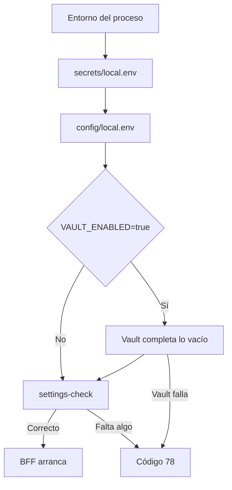

# Entornos

Iris separa dos configuraciones por entorno: la del **frontend** (build de Angular, valores públicos) y la del **BFF** (variables de entorno, incluidos los secretos). El navegador nunca recibe secretos: en `src/environments/*` solo hay valores públicos y la API se consume por el BFF con URL relativa (`/mrc/api/v1`).

## Equivalencias `ENVM`

`ENVM` elige la configuración de build de Angular (`pnpm build`, `pnpm build:ssr`, `pnpm serve:integrated`). Un valor que no exista falla con `Configuration '<valor>' for target 'build' ... is not set`; `prod` **no** es válido, el nombre es `production`.

| `ENVM` | Configuración Angular (`build` y `server`) | Archivo de entorno | Optimizado | Uso |
|---|---|---|:-:|---|
| `development` | `development` | `environment.ts` | No | Desarrollo local (`pnpm start`, `build:dev`) |
| `dev` | `dev` | `environment.dev.ts` | Sí | Despliegue en el entorno de desarrollo |
| `qa` | `qa` | `environment.qa.ts` | Sí | Despliegue en QA |
| `dev-cloud` | `dev-cloud` | `environment.dev-cloud.ts` | Sí | Despliegue en la nube, desarrollo |
| `qa-cloud` | `qa-cloud` | `environment.qa-cloud.ts` | Sí | Despliegue en la nube, QA |
| `production` | `production` | `environment.prod.ts` | Sí | Producción (`production: true`) |

Las configuraciones optimizadas comparten presupuestos (`initial` 500 kB aviso / 1 MB error) y hash de salida con `production`; solo cambia el archivo de entorno que sustituye a `environment.ts`. `build:ssr` pasa `ENVM` también al target `server` (antes lo compilaba siempre como `production`).

## Valores del frontend

Todos los entornos definen `production` y `apiBaseUrl: '/mrc/api/v1'` (URL relativa al BFF); el resto sale de `DEFAULT_APP_CONFIG` ([Configuración](frontend.md#configuración)). Para que un entorno cambie algo, se agrega la clave a su `environment.<x>.ts`. No hay `apiKey` ni URLs absolutas en estos archivos.

## BFF por entorno

El BFF no tiene archivos de configuración por entorno (no existen `server/config/{dev,qa,production}.json`): lee variables de entorno con valor por defecto para desarrollo (`server/config/constants.js`, `config/local.env`). Cada despliegue define las suyas; la correspondencia con `ENVM` es esta:

| `ENVM` | `NODE_ENV` | Qué cambia en el BFF |
|---|---|---|
| `development` | `development` | Defaults locales; `BACKBONE_TLS_INSECURE` permitido; Mercury `http://localhost:8080`, Backbone `http://localhost:8443` |
| `dev`, `dev-cloud` | `development` o `production` según el despliegue | `MERCURY_BASE_URL`, `BACKBONE_BASE_URL` y `CORS_ORIGIN` del entorno |
| `qa`, `qa-cloud` | `production` recomendado | Igual que arriba con los servicios de QA |
| `production` | `production` | Exige `BACKBONE_APPLICATION_ID`, `BACKBONE_CLIENT_ID` y `BACKBONE_CLIENT_SECRET`; prohíbe `BACKBONE_TLS_INSECURE` y `TRUST_PROXY=true`; `COOKIE_SECURE=true` si se sirve por HTTPS |

Los secretos (`BACKBONE_CLIENT_SECRET`, `MERCURY_LOGIN_PASSWORD`) salen del gestor de secretos del entorno, nunca de git ni de `environment*.ts`. Si falta algo obligatorio el BFF termina con código 78 y la lista de problemas (`settings-check`).

## Dónde van las variables

Se usan los mismos archivos que Mercury y ZeroBound. Las variables pueden estar en `local.env`, en Vault o repartidas entre ambos, y se leen igual en local y en Docker.

| Fuente | Versionado | Contenido |
|---|---|---|
| Entorno del proceso | n/a | `environment:` de `docker-compose.yml`, ConfigMap o Secret de Kubernetes, shell |
| `secrets/local.env` | No (copia de `secrets/local.env.example`) | Credenciales o `VAULT_TOKEN`; admite cualquier otra variable |
| `config/local.env` | Sí | Valores no secretos y la conexión a Vault |
| Vault (`VAULT_ENABLED=true`) | n/a | Lo que siga vacío, leído de `VAULT_PATH` al arrancar |

La tabla va de mayor a menor prioridad: un valor vacío cuenta como no definido y uno escrito gana a Vault.

En local, `pnpm dev` levanta `ng serve` y el BFF. `pnpm start:bff` carga los dos archivos en `package.json`, igual que en zerobound-frontend, y arranca `node server.js` (`pnpm start:bff:win` en Windows). `pnpm start` solo levanta `ng serve`: no lee estos archivos. Después, `server/config/load-environment.js` lee Vault antes de cargar `constants.js`. Ese módulo también lee los archivos, para que `node server.js` funcione sin el script, por ejemplo en Windows. Con `pnpm start:bff`, un valor escrito en estos archivos reemplaza al que venga del shell.

- `VAULT_ENABLED=true` exige `VAULT_URI`, `VAULT_PATH` y `VAULT_TOKEN`. Si Vault no responde, el BFF termina con código 78 y no usa una configuración parcial.
- La ruta es KV v2 con el segmento `data`, como en smartkin-frontend: `dev/data/iris/qa`.
- `VAULT_TOKEN` se borra del entorno tras usarlo y no aparece en logs ni en errores.
- En Kubernetes, `secrets/local.env` crea el Secret `iris-secrets`.
- `.env` es opcional y no llega al BFF: Compose solo lo usa para sustituir `${ENVM}`, `${BFF_TLS_DIR}` y `${UMDC_GATEWAY_IP}`.
- `ENVM` es de build: el BFF no la lee y `pnpm build` la toma del shell.

## Certificados

- **BFF**: HTTPS opcional con `SSL_CERT_PATH` y `SSL_KEY_PATH` (ambas juntas, fuera de git). Sin ellas sirve HTTP.
- **Backbone/Mercury con certificado autofirmado**: solo en desarrollo, `BACKBONE_TLS_INSECURE=true`.
- **Backbone/Mercury con la CA interna, en Docker**: `NODE_EXTRA_CA_CERTS` apunta a `umdc-local-ca.crt`, montado por `docker-compose.yml`.
- **`ng serve`**: el proxy de desarrollo acepta certificados autofirmados del BFF (`IRIS_BFF_URL=https://...`).

## Variables

| Variable | Dónde se usa | Detalle |
|---|---|---|
| `ENVM` | build | Tabla de arriba |
| `IRIS_BFF_URL` | `pnpm start` | Destino del proxy de `ng serve` (por defecto `http://localhost:4000`) |
| `NODE_ENV`, `PORT`, `MERCURY_*`, `BACKBONE_*`, `COOKIE_SECURE`, `CORS_ORIGIN`, `TRUST_PROXY`, `RATE_LIMIT_MAX`, `LOGIN_RATE_LIMIT_MAX`, `TRACING_ENABLED`, `TRACE_SAMPLE_RATE`, `SSL_*` | BFF | Comentadas en [`config/local.env`](../../config/local.env), [`secrets/local.env.example`](../../secrets/local.env.example) y en [DEVELOPMENT_SETUP.md](../../DEVELOPMENT_SETUP.md) |

## Verificación en CI

El job `Build por entorno` de `.github/workflows/ci.yml` ejecuta `pnpm build:ssr` para cada `ENVM` válido, de modo que una configuración rota falla en el PR.
