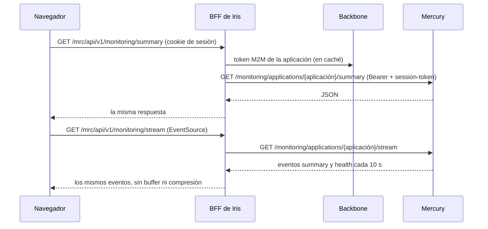
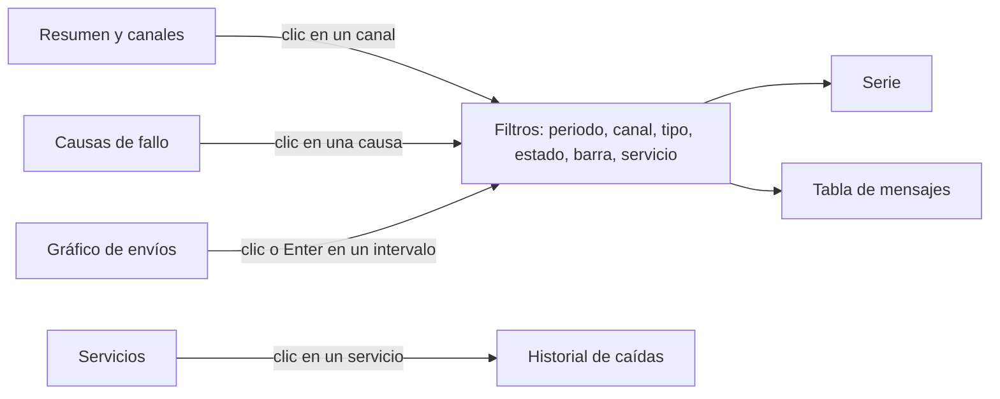
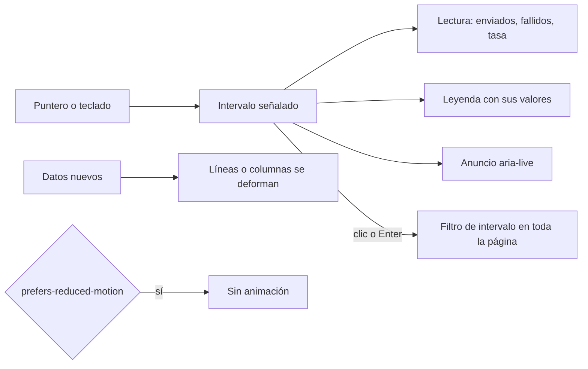
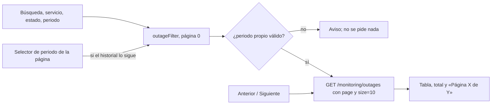
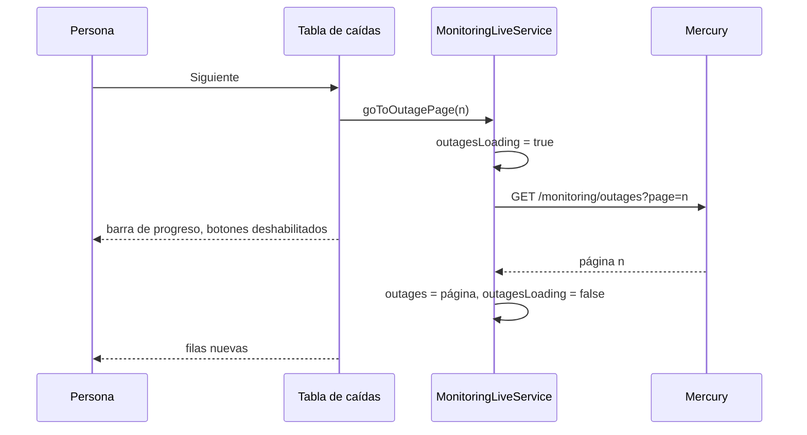

# Monitoreo de envíos

La sección **Monitoreo** (`/dashboard/monitoring`) muestra, casi en tiempo real, cómo van los envíos de la aplicación (correo, Telegram, SMS, WhatsApp, Push y códigos de verificación) y si los servicios que los hacen posibles están arriba. Iris no calcula nada: dibuja lo que Mercury responde en `/api/v1/monitoring/*` (ver `docs/tec/en/24-monitoring-api.md` y `25-monitoring-health-and-stream.md` en el repositorio de Mercury).

## Rutas del BFF

`server/routes/monitoring-live.routes.js`. Todas son `GET`, necesitan la cookie de sesión y llevan `Cache-Control: no-store`.

| Ruta | Mercury | Parámetros admitidos |
|---|---|---|
| `/monitoring/summary` | `/monitoring/applications/{app}/summary` | `range` |
| `/monitoring/series` | `.../series` | `range`, `channel`, `kind` |
| `/monitoring/failures` | `.../failures` | `range` |
| `/monitoring/verification-codes` | `.../verification-codes` | `range` |
| `/monitoring/messages` | `.../messages` | `channel`, `status`, `kind`, `templateDefinedId`, `from`, `to`, `page`, `size` |
| `/monitoring/health` | `/monitoring/health` | — |
| `/monitoring/outages` | `/monitoring/health/outages` | `range`, `from`, `to` (`2026-11-16T10:00:00`, UTC), `q` (hasta 100 caracteres, sin caracteres de control), `service`, `status` (`DOWN`, `DEGRADED`), `page`, `size` |
| `/monitoring/stream` | `.../stream` (SSE) | `range` |

- **El monitoreo es de Mercury, no de un cliente:** sin elegir otra, las vistas cubren **todas las aplicaciones** (el BFF manda a Mercury el UUID nulo `00000000-0000-0000-0000-000000000000`); no hace falta `MONITORED_APPLICATION_ID`. La persona puede acotar a una aplicación con `applicationId` (ver más abajo); un valor que no es UUID es `400` y una aplicación que no puede mirar es `403`.
- **Solo pasan los parámetros de la tabla.** Cada valor debe ser corto y de caracteres simples; `range` es `1h`, `24h`, `7d` o `30d`; `templateDefinedId` un UUID; `page` y `size` enteros. Cualquier otra cosa es `400` y no se llama a Mercury.
- **Credenciales:** `Authorization: Bearer` del cliente de la aplicación (necesita `mercury:message:read` en `BACKBONE_CLIENT_SCOPES`, ya presente para campañas) y `session-token` de la persona. Las vistas JSON usan `proxyToApi`, que renueva la sesión una vez ante un `401`. Si Backbone rechaza al cliente de la aplicación, `502`.
- **El stream** (`GET /monitoring/stream`) abre la conexión con Mercury, la pasa tal cual al navegador (`text/event-stream`, `Cache-Control: no-store, no-transform`, `X-Accel-Buffering: no`) y la cierra cuando el navegador se va. Un rechazo de Mercury llega como JSON con su estado (`400`, `401`, `403`, `429`; cualquier otro, `502`) para que la página siga con sondeo. `compression()` no comprime `text/event-stream`: el buffer de la compresión retendría los eventos. Detrás de nginx hace falta `proxy_buffering off` para esta ruta (o el encabezado `X-Accel-Buffering`, que ya se envía).

## Elegir la aplicación y avisar si Mercury no registra

Mercury (y por tanto Iris) monitorea **todas** las comunicaciones que pasan por él, las envíe ZeroBound, Iris o cualquier otro cliente. Mercury guarda cada envío con la aplicación de la definición de plantilla que usó, y eso sirve para **acotar**, no para limitar.

- **Selector «Aplicación»** (aparece si Mercury lista aplicaciones para la persona): «Todas las aplicaciones» (lo normal) o una. `GET /monitoring/applications` devuelve `{ applications, available }` con las que Mercury lista para la persona (`/templates/applications`; todas para un administrador de la plataforma, las que administra para el resto). Todas las rutas aceptan `applicationId`: sin él, todas; un valor que no es UUID es `400`; uno que la persona no puede mirar es `403` y no se llama a Mercury (`00000000-0000-0000-0000-000000000000` equivale a todas). La lista se pide una vez por minuto y sesión. Aplica a las vistas, al stream, a la exportación, al reintento y a las reglas (una regla creada sin elegir aplicación es de todas); cambiar de aplicación quita los filtros y reabre el stream.
- **Aviso de almacenamiento:** `health.storage` (en `/monitoring/health` y en el evento `health` del stream) dice si existen las tablas de monitoreo de Mercury. Si faltan (migraciones `V2039` a `V2041` sin aplicar, p. ej. con `MERCURY_FLYWAY_ENABLED=false`) la página muestra un aviso rojo con las tablas y los scripts; si hay tablas pero fallaron registros, un aviso amarillo con la cuenta.
- **Qué hacer si la página está vacía y Mercury envió:** ver `docs/tec/en/24-monitoring-api.md` de Mercury, sección *Nothing appears in the dashboard*.

## Alertas, reintento y exportación (fase 4)

Rutas de escritura y de archivo, en el mismo `server/routes/monitoring-live.routes.js`:

| Ruta | Mercury | Notas |
|---|---|---|
| `GET /monitoring/alerts?range=` | `.../alerts` | Alertas que suenan ahora y las recientes. |
| `GET /monitoring/alerts/rules` | `.../alerts/rules` | Reglas de la aplicación. |
| `POST /monitoring/alerts/rules` | `.../alerts/rules` | Crea una regla. **Escritura.** |
| `PUT /monitoring/alerts/rules/:id` | `.../alerts/rules/{id}` | Reemplaza la regla. **Escritura.** |
| `DELETE /monitoring/alerts/rules/:id` | `.../alerts/rules/{id}` | La borra con sus alertas. **Escritura.** |
| `POST /monitoring/messages/:id/retry` | `.../messages/{id}/retry` | Vuelve a poner en cola un correo fallido. **Escritura.** |
| `GET /monitoring/messages/export?format=csv\|json&...` | `.../messages/export` | Archivo con los filtros de la tabla; pasa `Content-Disposition`, `X-Total-Count` y `X-Export-Truncated`. |

- **Permiso de escritura.** Las rutas de escritura necesitan que el cliente de aplicación pida `mercury:message:write` en `BACKBONE_CLIENT_SCOPES` (registrado antes en el cliente M2M de Backbone, como para escribir campañas). Sin él Mercury responde `403` y la página lo avisa; ver y exportar siguen funcionando con `mercury:message:read`.
- **Cuerpo de una regla:** solo pasan `type`, `threshold`, `windowMinutes`, `minVolume`, `service`, `notifyEmails` (hasta 5) y `enabled`, con su tipo comprobado; cualquier otro campo (por ejemplo `applicationId` o `id`) se descarta. El id de la URL debe ser un UUID. Las escrituras llevan el encabezado `x-iris-csrf: 1` como el resto de la API.
- **Página:** un aviso rojo (`role="alert"`) lista las alertas que suenan; la sección «Alertas» muestra las reglas (activar/desactivar, eliminar), el formulario de una regla nueva (se valida en el navegador y Mercury vuelve a validar) y las últimas alertas resueltas; la tabla de mensajes tiene «Reintentar» (solo en un correo fallido con id) y «Exportar CSV/JSON». La exportación se descarga con `HttpClient` (así los errores pasan por el interceptor) y avisa si el archivo está incompleto.
- **Servicios de una regla «servicio caído»:** `POSTGRESQL`, `MONGODB`, `KAFKA`, `SMTP`, `BACKBONE` y `TELEGRAM`, los mismos nombres que Mercury da en `/monitoring/health` (otro nombre es un `400`).
- El reintento no reescribe la historia: el intento fallido sigue en la tabla y el nuevo se suma.

## La página

`features/dashboard/pages/monitoring-page` y `services/monitoring-live.service.ts` (uno por página: se crea al entrar y se destruye al salir).

- **Enlazadas:** elegir un canal, un tipo, «Enviados/Fallidos», una barra de la gráfica o una causa de fallo filtra las demás vistas y la tabla; elegirlo otra vez lo quita, y los chips de «Filtros activos» también. Elegir un servicio filtra el historial de caídas (en Mercury, en todas sus páginas). Cambiar el periodo quita la barra elegida (ya no existe en la serie nueva). La tabla de mensajes cubre el periodo elegido, o el intervalo de la barra.
- **En vivo:** `EventSource` (con cookies) recibe `summary` y `health` cada 10 s. El resto (serie, fallos, códigos, caídas, mensajes) se consulta cada 30 s, y no se consulta con la pestaña oculta. Si el stream es rechazado, o `EventSource` no existe, se consulta todo cada 15 s y se reintenta el stream cada minuto. Mercury cierra el stream a los 15 min y el navegador reconecta solo (eso vuelve a validar la sesión).
- **Honestidad:** sin datos no hay cifras (marcadores de carga); sin envíos no hay tasa («Sin datos»); un canal sin proveedor (SMS, WhatsApp, Push) se muestra «En cola, sin proveedor»; si una consulta falla aparece el aviso «los datos pueden estar desactualizados» y el indicador pasa a «Sin conexión». El estado de un servicio siempre lleva texto además del color.
- **Fechas:** Mercury las envía en UTC sin zona; la página las lee como UTC y las muestra así (`Fecha (UTC)`).
- **Gráficos:** SVG propio (`time-series-chart`, `trend-spark`, `ratio-bar`, `animated-number`, geometría en `utils/chart-geometry.ts`), sin librería, por el tamaño del paquete y porque los gráficos son pocos; ver *Diseño de los gráficos*.

### Diseño de los gráficos

Rediseñados con un método fijo: primero la forma según lo que el dato tiene que decir, después el color (validado con un script, no a ojo), marcas finas, cursor con lectura por defecto, tabla equivalente y modo oscuro con sus propios tonos.

| Dato | Forma | Pieza |
|---|---|---|
| La tasa de éxito (la cifra que manda) | Cifra principal de 48 px + **medidor** cuya pista es el mismo color más claro; estado con icono y texto (*Saludable* ≥ 95 %, *Atención* ≥ 80 %, *Crítico*) | `monitoring-page` |
| Enviados, fallidos, en cola | **Tarjetas** con la cifra (cuenta hasta el valor nuevo y destella) y la **tendencia** del periodo | `animated-number`, `trend-spark` |
| Envíos en el tiempo | **Líneas** suaves (monótonas: pasan exactamente por cada valor, sin rebotes por debajo de 0 ni picos inventados) con velo del 10 %, o **columnas apiladas** (≤ 24 px, punta redondeada de 4 px, base recta, 2 px de aire entre enviados y fallidos); se elige y se recuerda (`localStorage`) | `time-series-chart` |
| Tasa de fallos en el tiempo | **Gráfico aparte**, alineado debajo y con su propia escala (0 a un máximo redondo, como mucho 100 %): nunca dos ejes en un mismo gráfico | `time-series-chart` |
| Reparto por canal y por tipo | **Lista de medidores**: nombre, barra segmentada fina (8 px, extremos redondos) y cifras alineadas; clic filtra | `ratio-bar` (`thin`) |
| Causas de fallo | **Barras horizontales ordenadas**, una sola tinta, valor en la punta | `monitoring-page` |
| Códigos de verificación | **Barra segmentada alta** (28 px): confirmados, vencidos y pendientes, con su porcentaje dentro solo donde cabe; leyenda y cifras debajo | `ratio-bar` (`tall`) |

**Gráfico de envíos (`time-series-chart`)**

- **Tamaño:** se dibuja en píxeles reales (`observeWidth`, con `ResizeObserver`): gana ancho en pantallas grandes pero su alto es fijo (~270 px). Antes se estiraba con `viewBox` y en una pantalla ancha crecía hasta ocupar casi toda la vista.
- **Cursor:** una línea vertical sigue al puntero y se ajusta al intervalo más cercano en los dos gráficos (el de envíos y el de tasa), con puntos en cada serie y una lectura con el intervalo (`dd/MM HH:mm–HH:mm` UTC), enviados, fallidos y tasa de fallos; la leyenda pasa a mostrar los valores de ese intervalo. Sin cursor, la leyenda muestra el total del periodo.
- **Teclado:** el gráfico recibe el foco; flechas, Inicio y Fin recorren los intervalos, Enter o espacio filtran por el intervalo, Escape suelta. Un texto oculto (`aria-live`) anuncia cada intervalo.
- **Elegir:** clic o Enter filtra la página por el intervalo, que queda sombreado en los dos gráficos y en la tabla.
- **Intervalo en curso:** el último tramo va punteado y rotulado *en curso* (en columnas, atenuado): aún está incompleto, no es una caída.
- **Valores al final de cada línea** solo si no se pisan; si no, la leyenda los dice.
- **Tabla:** *Ver tabla* muestra los mismos datos por intervalo (accesible sin el gráfico).
- **Actualización:** mientras llegan datos el gráfico se queda y se atenúa (sin esqueleto ni saltos); las líneas se trazan al cambiar el periodo o el tipo y se deforman con suavidad cuando cambian los valores (`d` como propiedad CSS).

**Color.** Tres tonos propios de los datos, en `src/styles.css`, con un valor para claro y otro para oscuro: `--viz-sent` (azul), `--viz-failed` (rojo) y `--viz-waiting` (violeta, en cola o pendientes). Pasan el validador de paleta (banda de luminosidad, croma mínimo, separación para daltonismo ≥ 8 y visión normal ≥ 15 entre vecinos, contraste ≥ 3:1 sobre la tarjeta) en los dos modos; los `--chart-2`/`--chart-5` anteriores no lo pasaban. El orden es siempre enviados, fallidos, en espera: azul y violeta nunca quedan juntos, porque juntos no se distinguen. El texto nunca lleva el color de la serie (la marca de al lado lo lleva). Los estados (Saludable/Atención/Crítico) usan los colores de estado con icono y texto.

- **Movimiento responsable:** con `prefers-reduced-motion: reduce` (o sin `matchMedia`/`requestAnimationFrame`, como en las pruebas) no hay animaciones ni transiciones.
- **Indicadores que laten:** el punto «En vivo» y el de un servicio **Caído** laten (`iris-live-dot`).
- **Precisión:** Mercury devuelve todos los intervalos del periodo (también los vacíos), así que el eje de tiempo no se comprime; el eje de cantidades usa un máximo redondo por encima del mayor valor.
- **El inicio** (`/dashboard/home`) conserva sus tarjetas de campañas y enlaza a esta sección.

## Historial de caídas

El historial crece con el tiempo, así que se pagina en Mercury (`GET /monitoring/health/outages` devuelve una página y el total) y nunca se trae entero. Tiene su propia sección, debajo del estado de los servicios.

| Control | Qué envía | Notas |
|---|---|---|
| Buscar | `q` | Servicio, código de causa o descripción; se pide 300 ms después de la última tecla. |
| Servicio | `service` | Es el mismo filtro que pulsar una tarjeta de salud (y su chip en «Filtros activos»). |
| Estado | `status` | Caído (`DOWN`) o Degradado (`DEGRADED`). |
| Periodo | `range`, o `from`/`to` | *El periodo de la página* (por defecto, sigue al selector de arriba), 24 h, 7 o 30 días (`range`), *90 días* (`from` = hace 90 días: lo que Mercury guarda) o *Elegir fechas…* (`from` y, si se da, `to`, en UTC). |
| Anterior / Siguiente | `page` (`size` = 10) | Cada cambio de filtro vuelve a la primera página. |

- `MonitoringLiveService` guarda `outageFilter` (periodo, desde, hasta, texto, estado, página); el servicio es `service`. `windowProblem` revisa un periodo propio: falta el inicio, el fin no es posterior, o empieza antes de los 90 días que Mercury guarda; con un problema la página lo dice y no pide nada.
- **Progreso de carga:** `loadOutages` marca `outagesLoading` (señal de solo lectura) desde que pide la página hasta que responde o falla. Solo cuenta la última petición (`outageRequestId`): una respuesta tardía de otra página se descarta y no apaga el progreso. La tabla muestra una barra indeterminada (`.outage-progress`, `role="progressbar"`), se atenúa, lleva `aria-busy` y **Anterior**/**Siguiente** se deshabilitan mientras tanto; con `prefers-reduced-motion` la barra no se anima.

- El historial no depende de la aplicación elegida (la salud es de Mercury), así que no lleva `applicationId`.
- Las actualizaciones periódicas vuelven a pedir la página actual con sus filtros; cambiar el periodo de la página vuelve el historial a su primera página solo si lo sigue.
- **Requiere** Mercury con el historial paginado (PR um-dev-creative/mercury#111). Contra un Mercury anterior, `range` sigue funcionando pero llega todo en una página y los demás filtros se ignoran.

## Pruebas

- BFF: `server/test/monitoring-actions.spec.js` (exportar, reintentar, reglas), `server/test/monitoring-live*.spec.js` (rutas, parámetros, aplicación fija, credenciales, stream real con eventos escritos después de abrirlo, cierre en ambos sentidos, rechazos, Mercury caído, cliente rechazado, sin aplicación). El doble de Mercury del `harness.js` tiene `state.live`.
- Frontend: specs de `monitoring-live.service` (consulta del historial por periodo, filtros, páginas y `windowProblem`), `monitoring-page` (búsqueda con espera, filtros, fechas propias, páginas, vacíos), `time-series-chart` (tamaño fijo, líneas exactas, columnas, escala de la tasa, cursor, puntero, teclado, intervalo en curso, tabla, tipo recordado), `trend-spark`, `ratio-bar` (fina y alta, etiquetas que caben), `animated-number`, `utils/chart-geometry` (curva monótona sin rebotes, columnas, `observeWidth`), `utils/chart-scale` y `utils/monitoring-live`; `FakeEventSource` en `monitoring-live.testing.ts`.
- Revisión visual: capturas en Chrome sin interfaz (claro/oscuro, líneas/columnas, 1 h/24 h/30 días, escritorio y 390 px) contra datos simulados, con el cursor, el clic y el teclado probados y sin errores en la consola.
