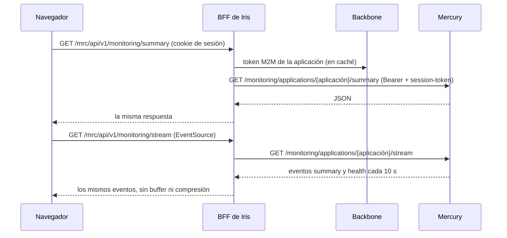
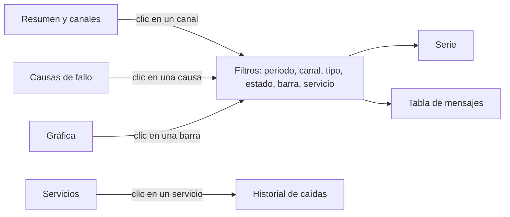
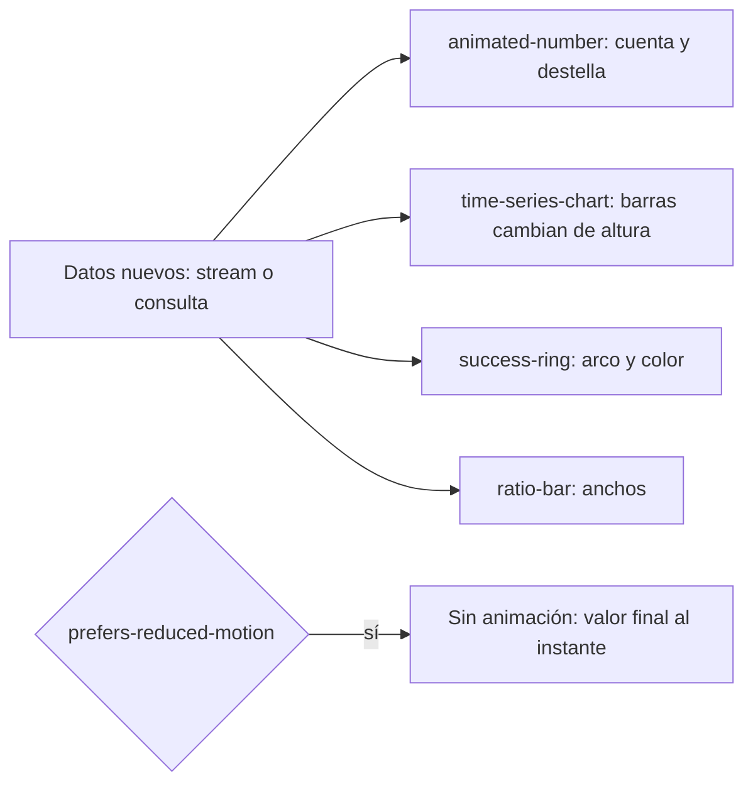

# Monitoreo de envíos

La sección **Monitoreo** (`/dashboard/monitoring`) muestra, casi en tiempo real, cómo van los envíos de la aplicación (correo, Telegram, SMS, WhatsApp, Push y códigos de verificación) y si los servicios que los hacen posibles están arriba. Iris no calcula nada: dibuja lo que Mercury responde en `/api/v1/monitoring/*` (ver `docs/tec/en/24-monitoring-api.md` y `25-monitoring-health-and-stream.md` en el repositorio de Mercury).

## Rutas del BFF

`server/routes/monitoring-live.routes.js`. Todas son `GET`, necesitan la cookie de sesión y llevan `Cache-Control: no-store`.

| Ruta | Mercury | Parámetros admitidos |
|---|---|---|
| `/monitoring/summary` | `/monitoring/applications/{app}/summary` | `range` |
| `/monitoring/series` | `.../series` | `range`, `channel`, `kind` |
| `/monitoring/failures` | `.../failures` | `range` |
| `/monitoring/verification-codes` | `.../verification-codes` | `range` |
| `/monitoring/messages` | `.../messages` | `channel`, `status`, `kind`, `templateDefinedId`, `from`, `to`, `page`, `size` |
| `/monitoring/health` | `/monitoring/health` | — |
| `/monitoring/outages` | `/monitoring/health/outages` | `range` |
| `/monitoring/stream` | `.../stream` (SSE) | `range` |

- **El monitoreo es de Mercury, no de un cliente:** sin elegir otra, las vistas cubren **todas las aplicaciones** (el BFF manda a Mercury el UUID nulo `00000000-0000-0000-0000-000000000000`); no hace falta `MONITORED_APPLICATION_ID`. La persona puede acotar a una aplicación con `applicationId` (ver más abajo); un valor que no es UUID es `400` y una aplicación que no puede mirar es `403`.
- **Solo pasan los parámetros de la tabla.** Cada valor debe ser corto y de caracteres simples; `range` es `1h`, `24h`, `7d` o `30d`; `templateDefinedId` un UUID; `page` y `size` enteros. Cualquier otra cosa es `400` y no se llama a Mercury.
- **Credenciales:** `Authorization: Bearer` del cliente de la aplicación (necesita `mercury:message:read` en `BACKBONE_CLIENT_SCOPES`, ya presente para campañas) y `session-token` de la persona. Las vistas JSON usan `proxyToApi`, que renueva la sesión una vez ante un `401`. Si Backbone rechaza al cliente de la aplicación, `502`.
- **El stream** (`GET /monitoring/stream`) abre la conexión con Mercury, la pasa tal cual al navegador (`text/event-stream`, `Cache-Control: no-store, no-transform`, `X-Accel-Buffering: no`) y la cierra cuando el navegador se va. Un rechazo de Mercury llega como JSON con su estado (`400`, `401`, `403`, `429`; cualquier otro, `502`) para que la página siga con sondeo. `compression()` no comprime `text/event-stream`: el buffer de la compresión retendría los eventos. Detrás de nginx hace falta `proxy_buffering off` para esta ruta (o el encabezado `X-Accel-Buffering`, que ya se envía).

## Elegir la aplicación y avisar si Mercury no registra

Mercury (y por tanto Iris) monitorea **todas** las comunicaciones que pasan por él, las envíe ZeroBound, Iris o cualquier otro cliente. Mercury guarda cada envío con la aplicación de la definición de plantilla que usó, y eso sirve para **acotar**, no para limitar.

- **Selector «Aplicación»** (aparece si Mercury lista aplicaciones para la persona): «Todas las aplicaciones» (lo normal) o una. `GET /monitoring/applications` devuelve `{ applications, available }` con las que Mercury lista para la persona (`/templates/applications`; todas para un administrador de la plataforma, las que administra para el resto). Todas las rutas aceptan `applicationId`: sin él, todas; un valor que no es UUID es `400`; uno que la persona no puede mirar es `403` y no se llama a Mercury (`00000000-0000-0000-0000-000000000000` equivale a todas). La lista se pide una vez por minuto y sesión. Aplica a las vistas, al stream, a la exportación, al reintento y a las reglas (una regla creada sin elegir aplicación es de todas); cambiar de aplicación quita los filtros y reabre el stream.
- **Aviso de almacenamiento:** `health.storage` (en `/monitoring/health` y en el evento `health` del stream) dice si existen las tablas de monitoreo de Mercury. Si faltan (migraciones `V2039` a `V2041` sin aplicar, p. ej. con `MERCURY_FLYWAY_ENABLED=false`) la página muestra un aviso rojo con las tablas y los scripts; si hay tablas pero fallaron registros, un aviso amarillo con la cuenta.
- **Qué hacer si la página está vacía y Mercury envió:** ver `docs/tec/en/24-monitoring-api.md` de Mercury, sección *Nothing appears in the dashboard*.

## Alertas, reintento y exportación (fase 4)

Rutas de escritura y de archivo, en el mismo `server/routes/monitoring-live.routes.js`:

| Ruta | Mercury | Notas |
|---|---|---|
| `GET /monitoring/alerts?range=` | `.../alerts` | Alertas que suenan ahora y las recientes. |
| `GET /monitoring/alerts/rules` | `.../alerts/rules` | Reglas de la aplicación. |
| `POST /monitoring/alerts/rules` | `.../alerts/rules` | Crea una regla. **Escritura.** |
| `PUT /monitoring/alerts/rules/:id` | `.../alerts/rules/{id}` | Reemplaza la regla. **Escritura.** |
| `DELETE /monitoring/alerts/rules/:id` | `.../alerts/rules/{id}` | La borra con sus alertas. **Escritura.** |
| `POST /monitoring/messages/:id/retry` | `.../messages/{id}/retry` | Vuelve a poner en cola un correo fallido. **Escritura.** |
| `GET /monitoring/messages/export?format=csv\|json&...` | `.../messages/export` | Archivo con los filtros de la tabla; pasa `Content-Disposition`, `X-Total-Count` y `X-Export-Truncated`. |

- **Permiso de escritura.** Las rutas de escritura necesitan que el cliente de aplicación pida `mercury:message:write` en `BACKBONE_CLIENT_SCOPES` (registrado antes en el cliente M2M de Backbone, como para escribir campañas). Sin él Mercury responde `403` y la página lo avisa; ver y exportar siguen funcionando con `mercury:message:read`.
- **Cuerpo de una regla:** solo pasan `type`, `threshold`, `windowMinutes`, `minVolume`, `service`, `notifyEmails` (hasta 5) y `enabled`, con su tipo comprobado; cualquier otro campo (por ejemplo `applicationId` o `id`) se descarta. El id de la URL debe ser un UUID. Las escrituras llevan el encabezado `x-iris-csrf: 1` como el resto de la API.
- **Página:** un aviso rojo (`role="alert"`) lista las alertas que suenan; la sección «Alertas» muestra las reglas (activar/desactivar, eliminar), el formulario de una regla nueva (se valida en el navegador y Mercury vuelve a validar) y las últimas alertas resueltas; la tabla de mensajes tiene «Reintentar» (solo en un correo fallido con id) y «Exportar CSV/JSON». La exportación se descarga con `HttpClient` (así los errores pasan por el interceptor) y avisa si el archivo está incompleto.
- **Servicios de una regla «servicio caído»:** `POSTGRESQL`, `MONGODB`, `KAFKA`, `SMTP`, `BACKBONE` y `TELEGRAM`, los mismos nombres que Mercury da en `/monitoring/health` (otro nombre es un `400`).
- El reintento no reescribe la historia: el intento fallido sigue en la tabla y el nuevo se suma.

## La página

`features/dashboard/pages/monitoring-page` y `services/monitoring-live.service.ts` (uno por página: se crea al entrar y se destruye al salir).

- **Enlazadas:** elegir un canal, un tipo, «Enviados/Fallidos», una barra de la gráfica o una causa de fallo filtra las demás vistas y la tabla; elegirlo otra vez lo quita, y los chips de «Filtros activos» también. Elegir un servicio filtra el historial de caídas. Cambiar el periodo quita la barra elegida (ya no existe en la serie nueva). La tabla de mensajes cubre el periodo elegido, o el intervalo de la barra.
- **En vivo:** `EventSource` (con cookies) recibe `summary` y `health` cada 10 s. El resto (serie, fallos, códigos, caídas, mensajes) se consulta cada 30 s, y no se consulta con la pestaña oculta. Si el stream es rechazado, o `EventSource` no existe, se consulta todo cada 15 s y se reintenta el stream cada minuto. Mercury cierra el stream a los 15 min y el navegador reconecta solo (eso vuelve a validar la sesión).
- **Honestidad:** sin datos no hay cifras (marcadores de carga); sin envíos no hay tasa («Sin datos»); un canal sin proveedor (SMS, WhatsApp, Push) se muestra «En cola, sin proveedor»; si una consulta falla aparece el aviso «los datos pueden estar desactualizados» y el indicador pasa a «Sin conexión». El estado de un servicio siempre lleva texto además del color.
- **Fechas:** Mercury las envía en UTC sin zona; la página las lee como UTC y las muestra así (`Fecha (UTC)`).
- **Gráfica:** SVG propio (`time-series-chart`, `success-ring`, `ratio-bar`, `animated-number`), sin librería: barras apiladas enviados/fallidos, cada barra es un botón con texto accesible. Se eligió SVG propio por el tamaño del paquete y porque los gráficos son pocos y sencillos.

### Gráficos vivos y precisos

| Pieza | Qué hace |
|---|---|
| `time-series-chart` | Eje de cantidades con marcas «redondas» (`niceScale`: pasos de 1, 2 o 5 por potencia de diez) y líneas guía; resumen del periodo (total, enviados, fallidos y pico); detalle al pasar el puntero o enfocar una barra (intervalo `dd/MM HH:mm–HH:mm` UTC, enviados, fallidos, tasa de fallos), que no se sale por los lados; el **intervalo en curso** (el último, si aún no termina) va rayado, lo dice su texto accesible y la leyenda, para no leer como caída lo que solo está incompleto. Las barras crecen desde la base al aparecer y cambian de altura con transición (`y`/`height` como propiedades CSS) cuando llegan datos. |
| `success-ring` | El arco sigue a la tasa con transición y cambia de color: verde desde 95 %, ámbar desde 80 %, rojo por debajo; debajo dice «N de M entregados». El texto del porcentaje sigue ahí: el color no es la única señal. |
| `animated-number` | Las cifras del resumen cuentan hasta el valor nuevo (650 ms, `requestAnimationFrame`) y destellan en verde si mejoran o en rojo si empeoran (`tone="inverse"` para fallidos y en cola). El lector de pantalla recibe solo el valor exacto. |
| `ratio-bar` | Barra apilada de proporción con texto accesible («Enviados: 90 (90.0 %), …»): resumen (enviados/fallidos), cada canal (enviados/fallidos/en cola y su parte del volumen), cada tipo, cada causa de fallo (frente a la más frecuente) y los códigos de verificación (confirmados/pendientes/vencidos). |

- **Movimiento responsable:** con `prefers-reduced-motion: reduce` (o sin `matchMedia`/`requestAnimationFrame`, como en las pruebas) no hay animaciones ni transiciones: se muestra el valor final. Los estilos (`iris-bar`, `iris-ratio-part`, `iris-ring-arc`, `iris-live-dot`, `iris-flash-*`) están en `src/styles.css`.
- **Indicadores que laten:** el punto «En vivo» y el de un servicio **Caído** laten (`iris-live-dot`).
- **Precisión:** Mercury ya devuelve todos los intervalos del periodo (también los vacíos), así que el eje de tiempo no se comprime; el eje de cantidades usa un máximo redondo por encima del mayor intervalo para leer valores exactos contra las líneas guía.
- **El inicio** (`/dashboard/home`) conserva sus tarjetas de campañas y enlaza a esta sección.

## Pruebas

- BFF: `server/test/monitoring-actions.spec.js` (exportar, reintentar, reglas), `server/test/monitoring-live*.spec.js` (rutas, parámetros, aplicación fija, credenciales, stream real con eventos escritos después de abrirlo, cierre en ambos sentidos, rechazos, Mercury caído, cliente rechazado, sin aplicación). El doble de Mercury del `harness.js` tiene `state.live`.
- Frontend: specs de `monitoring-live.service`, `monitoring-page`, `time-series-chart` (escala, detalle, intervalo en curso), `success-ring` (color), `ratio-bar`, `animated-number` (con `requestAnimationFrame` simulado), `utils/chart-scale` y `utils/monitoring-live`; `FakeEventSource` en `monitoring-live.testing.ts`.
