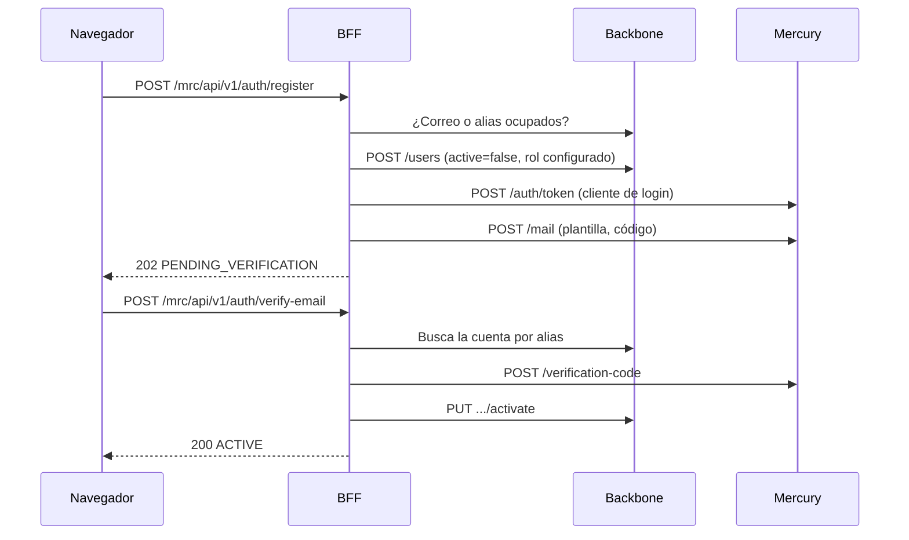

# Registro de usuarios

El BFF orquesta el alta: Iris no tiene base de datos propia. Backbone guarda la cuenta y Mercury envía y comprueba el código.

## Reglas

- El rol, la aplicación y el estado activo los decide el BFF: lo que envíe el navegador se ignora.
- Un correo ya registrado responde igual que uno nuevo, para no revelar quién tiene cuenta. Un alias ocupado responde 409.
- `resend-verification` responde siempre lo mismo, exista o no la cuenta.
- Las tres rutas limitan a `REGISTRATION_RATE_LIMIT_MAX` intentos por ventana.
- Sin configuración completa responden 503 y no crean nada.

## Configuración

| Variable | Uso |
|---|---|
| `REGISTRATION_ROLE_ID` | Rol en backbone de las cuentas nuevas. Debe ser de solo lectura. |
| `REGISTRATION_TEMPLATE_ES`, `REGISTRATION_TEMPLATE_EN` | `template_defined` de Mercury (`scripts/iris/seed-templates.sql`). |
| `REGISTRATION_MAIL_FROM` | Remitente del correo. |
| `MERCURY_LOGIN_ALIAS`, `MERCURY_LOGIN_PASSWORD` | Iris como cliente de login de Mercury. |
| `BACKBONE_CLIENT_ID`, `BACKBONE_CLIENT_SECRET` | Cliente M2M. Necesita permiso sobre `/users`. |

# Datos de monitoreo

`GET /mrc/api/v1/monitoring/overview` agrega lo que ya expone Mercury: lista las campañas de `MONITORED_APPLICATION_ID`, pide el progreso de las `MONITORING_MAX_CAMPAIGNS` más recientes y sondea la salud de Mercury y backbone.

Mercury exige dos credenciales en `/campaigns`: el `Bearer` del cliente M2M, con el scope `mercury:message:read`, y el `session-token` del usuario. Por eso `BACKBONE_CLIENT_SCOPES` debe incluir ese scope.

Mercury no tiene un registro por mensaje, así que el dashboard muestra campañas, no mensajes individuales. Si Mercury falla, la respuesta lleva `campaignsAvailable: false` y la interfaz lo indica: nunca muestra cifras inventadas.
