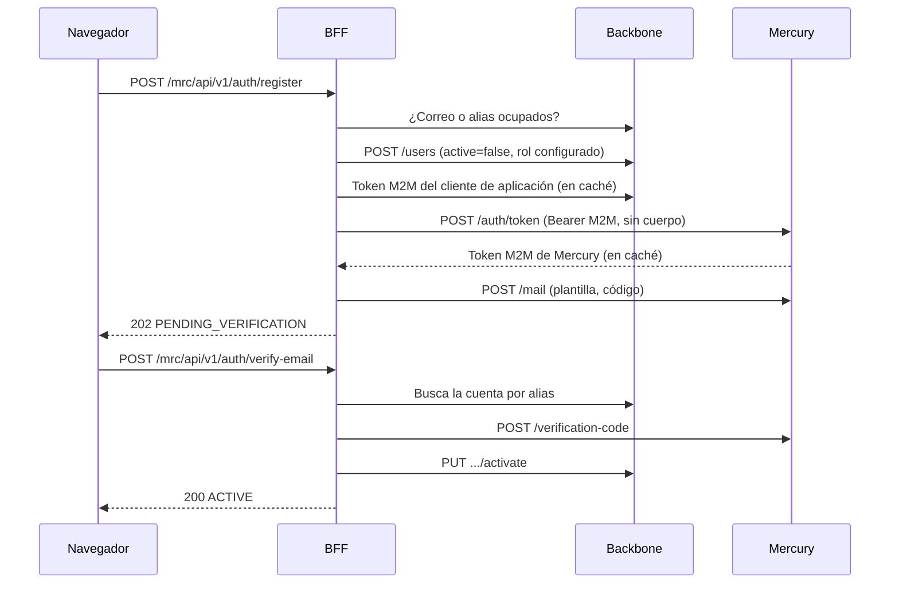
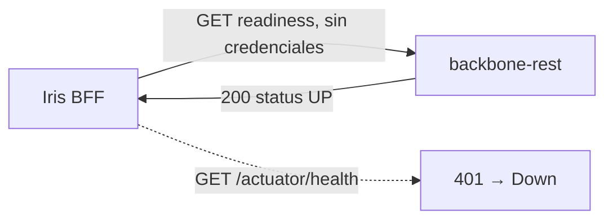
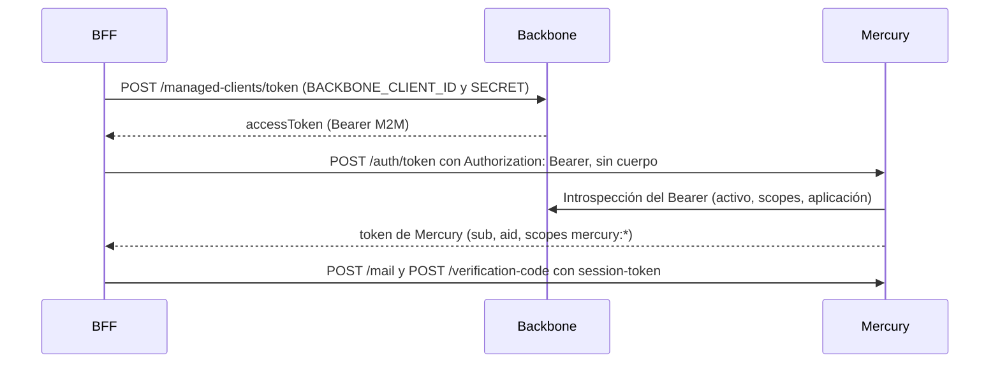

# Registro de usuarios

El BFF orquesta el alta: Iris no tiene base de datos propia. Backbone guarda la cuenta y Mercury envía y comprueba el código.

## Reglas

- El rol, la aplicación y el estado activo los decide el BFF: lo que envíe el navegador se ignora.
- Un correo ya registrado responde igual que uno nuevo, para no revelar quién tiene cuenta. Un alias ocupado responde 409.
- `resend-verification` responde siempre lo mismo, exista o no la cuenta.
- Las tres rutas limitan a `REGISTRATION_RATE_LIMIT_MAX` intentos por ventana.
- Sin configuración completa responden 503 y no crean nada. El BFF nombra lo que falta en el log al arrancar y en cada intento.

## Configuración

| Variable | Uso |
|---|---|
| `REGISTRATION_ROLE_ID` | Rol en backbone de las cuentas nuevas. Debe ser de solo lectura. |
| `REGISTRATION_TEMPLATE_ES`, `REGISTRATION_TEMPLATE_EN` | `template_defined` de Mercury (`scripts/iris/seed-templates.sql`). |
| `REGISTRATION_MAIL_FROM` | Remitente del correo. |
| `BACKBONE_CLIENT_ID`, `BACKBONE_CLIENT_SECRET` | Cliente M2M, el mismo que inicia sesión y que Mercury reconoce como Iris. Debe estar registrado en backbone para la misma aplicación que `BACKBONE_APPLICATION_ID` y tener el scope `users:manage` (además pedido en `BACKBONE_CLIENT_SCOPES`). Si no, backbone responde 403 al comprobar el correo y registra `Managed client '…' may not administer users of application '…'` (`UserAdminGuard`). |

# Datos de monitoreo

`GET /mrc/api/v1/monitoring/overview` agrega lo que ya expone Mercury: lista las campañas de `MONITORED_APPLICATION_ID`, pide el progreso de las `MONITORING_MAX_CAMPAIGNS` más recientes y sondea la salud de Mercury y backbone.

La sonda de backbone es `BACKBONE_HEALTH_PATH`, por defecto `/backbone/actuator/health/readiness`: backbone-rest solo deja pública `/actuator/health/liveness` y `/readiness`; el agregado `/actuator/health` exige sesión y responde 401, que el panel interpreta como «Down» aunque el servicio funcione. Si un servicio aparece «Down», el log del BFF lo explica: `Monitoring: the Backbone health probe /backbone/actuator/health/readiness answered 401` (ruta equivocada) o `failed: ECONNREFUSED` (sin conexión).

Mercury exige dos credenciales en `/campaigns`: el `Bearer` del cliente M2M, con el scope `mercury:message:read`, y el `session-token` del usuario. Por eso `BACKBONE_CLIENT_SCOPES` debe incluir ese scope.

Mercury no tiene un registro por mensaje, así que el dashboard muestra campañas, no mensajes individuales. Si Mercury falla, la respuesta lleva `campaignsAvailable: false` y la interfaz lo indica: nunca muestra cifras inventadas.

## Cómo obtiene Iris el token de Mercury

Mercury ya no tiene clientes de login: no hay alias ni contraseña de Mercury en Iris. El BFF cambia el token M2M que Backbone emitió al cliente de aplicación por el token M2M de Mercury:

- `/mail` y `/verification-code` cambian estado: el cliente debe pedir `mercury:message:write` en `BACKBONE_CLIENT_SCOPES` y tenerlo registrado en Backbone. Sin él Mercury responde 403 al cambio de token.
- Mercury ata el token a la aplicación que Backbone registra para el cliente; no hace falta enviarla.
- El token se guarda en memoria y se renueva un minuto antes de caducar; si Mercury responde 401 se pide uno nuevo una sola vez.
- Si el cambio falla, la cuenta queda creada e inactiva, el correo no se encola y el BFF lo registra como aviso (`The verification mail could not be queued`): la persona puede pedir otro código con `resend-verification`.
- Al arrancar, el BFF avisa del registro apagado y nombra lo que falta, incluido `BACKBONE_CLIENT_SCOPES (mercury:message:write)`.
- **Retirado:** `MERCURY_LOGIN_ALIAS` y `MERCURY_LOGIN_PASSWORD`. Si siguen en tus archivos, se ignoran: bórralas.
