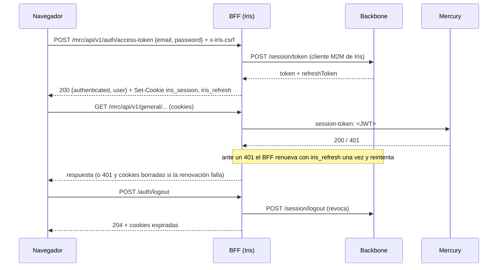

# Seguridad

## Sesión

El navegador nunca ve un token: el BFF guarda los JWT de Backbone en cookies `httpOnly` y los reenvía a Mercury y Backbone en la cabecera `session-token`. No hay sesión en el servidor (ni Redis), así que un reinicio del BFF no cierra sesiones.

### Atributos de las cookies

| Cookie | Atributos |
|---|---|
| `iris_session` (JWT de sesión) | `HttpOnly`, `SameSite=Strict`, `Path=/`, `Secure` cuando `COOKIE_SECURE=true` (obligatorio con HTTPS) |
| `iris_refresh` (JWT de renovación) | Igual. Ambas caducan con el refresh token |

### CSRF

Toda llamada que no sea `GET`/`HEAD`/`OPTIONS` bajo `/mrc/api/v1` y `/bkd/api/v1` exige la cabecera `x-iris-csrf: 1`; sin ella el BFF responde 403. Un sitio ajeno no puede añadirla sin un preflight CORS, y el BFF solo lo concede a `CORS_ORIGIN`. A esto se suma `SameSite=Strict`.

### Perfil de la sesión

`GET /mrc/api/v1/auth/me` (y el cuerpo del login) devuelve `{ authenticated, user }` con `user = { id, username, name, firstname, lastname, expiresAt, email?, avatarUrl? }`, armado solo con los claims del token de sesión; sin sesión, `401 { authenticated: false }`. Todas las respuestas de `/auth/*` llevan `Cache-Control: no-store`. `email` y `avatarUrl` aparecen únicamente si Backbone los incluye en el token; hoy el token trae `uid`, `username`, `firstname` y `lastname`.

### Mensajes

El login no distingue usuario inexistente de contraseña errónea (`401 {"error":"Invalid credentials"}`), limita los intentos (`LOGIN_RATE_LIMIT_MAX`) y no devuelve tokens en el cuerpo.

Detalles de implementación: [backend.md](backend.md#sesión).
