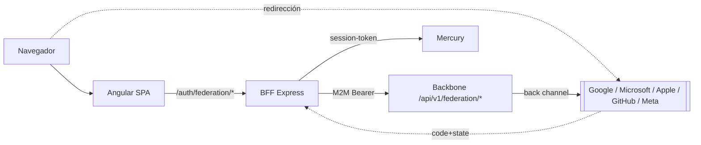
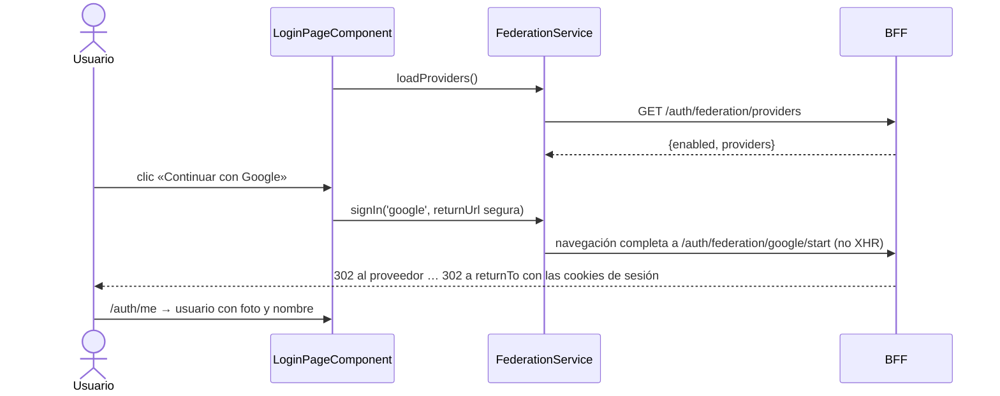

# Federación social en Iris (diseño propuesto)

> Estado: **implementado en el BFF y en Angular** (18 nov 2026), apagado por defecto (`FEDERATION_ENABLED=false`). Proveedores: Google, Microsoft, Apple, GitHub y Meta. Solo entran usuarios que ya existen. Requiere el Backbone con la federación (`V10`, `com.umdc:persistence` 0.0.4).
> Documentos hermanos en `backbone-rest`: `docs/requirements/social-federation.md` (requisitos), `docs/architecture/social-federation.md`
> (diseño de Backbone), `docs/plans/social-federation-implementation-plan.md` (plan por fases).

## 1. Qué cambia para Iris

Iris sigue hablando **solo con Backbone**. Backbone hace de *broker* de identidad: inicia el flujo OAuth 2.0 Authorization Code + PKCE
contra el proveedor (Google, Microsoft, Apple, GitHub o Meta), valida el ID token y devuelve el **mismo** par de tokens (`token`, `refreshToken` con `aid`) que el login por
contraseña. Por eso el BFF reutiliza `setSessionCookies`, `/auth/me`, el refresco y el logout sin cambios, y Mercury no se toca.

## 2. Rutas del BFF (`server/routes/federation.routes.js`, bajo `/mrc/api/v1/auth/federation`)

| Ruta | Método | Qué hace |
|---|---|---|
| `/providers` | GET | `{enabled, providers[]}` de la aplicación (para pintar los botones). Con la función apagada responde `{enabled:false, providers:[]}`; si Backbone falla, lista vacía: el acceso por contraseña sigue |
| `/:provider/start?returnTo=` | GET | Valida `returnTo`, pide `authorize` a Backbone, guarda la cookie `iris_fed_state` y redirige (302) al proveedor |
| `/callback?code&state` | GET | Compara `state` con la cookie; llama a `callback` de Backbone; fija las cookies de sesión (`iris_session`, `iris_refresh`) y redirige a `returnTo` |
| `/callback` | POST (form) | Lo mismo para **Apple** (`form_post`). Está fuera del chequeo CSRF por cabecera (un formulario de otro sitio no puede añadirla): lo protegen la cookie de estado y el `state` de un solo uso de Backbone |
| `/:provider/link` | POST | (sesión + CSRF) inicia el enlace de una cuenta: devuelve `{authorizationUrl}` y fija la cookie con `link:true` |
| `/identities` | GET | Cuentas enlazadas del usuario en sesión (`Authorization: Bearer` de la sesión hacia Backbone) |
| `/identities/:identityId` | DELETE | (CSRF) desenlaza; siempre permitido: la contraseña sigue existiendo |

Reglas del BFF:

- **`iris_fed_state`**: `HttpOnly; Secure; SameSite=Lax; Path=/mrc/api/v1/auth/federation; Max-Age=600`. Lax porque el proveedor vuelve con un GET de nivel superior; **Apple** usa `SameSite=None; Secure` porque su respuesta es un POST entre sitios. Contiene `{state, provider, returnTo, link}` (no es un secreto: el `state` solo sirve una vez y solo para el cliente que lo inició).
- **`returnTo`**: ruta relativa del mismo origen (empieza con una sola `/`, sin `\`, saltos de línea ni esquema) y bajo un prefijo de `FEDERATION_RETURN_TO_ALLOWLIST` (por defecto `/dashboard`); si no, `/dashboard`.
- Un `state` que no coincide con la cookie **no llama a Backbone** y termina en `/login?error=expired`.
- El callback siempre borra la cookie de estado. Un 403 de federación de Backbone (usuario no registrado, correo no permitido…) es sobre la persona, no una mala configuración del cliente de aplicación; solo `federation_client_rejected` se trata como error de configuración.
- Todas las respuestas llevan `Cache-Control: no-store`; los límites de tasa reutilizan `express-rate-limit` (3 × el del login). No se registran `code`, `state` ni tokens.

### Mapa de errores → `/login?error=<código>`

| Origen | Código | Mensaje en pantalla |
|---|---|---|
| IdP `error=access_denied` | `denied` | Cancelaste el inicio de sesión |
| `state` inválido/expirado/reutilizado | `expired` | El inicio de sesión expiró; vuelve a intentarlo |
| ID token inválido (`401`) | `failed` | No pudimos verificar tu cuenta |
| `403 federation_not_registered` (Iris nunca crea usuarios) | `not_registered` | Tu cuenta no está registrada; pide acceso a un administrador |
| `403` correo no verificado / dominio | `not_allowed` | Esta cuenta no tiene permiso |
| `502/503` | `unavailable` | Servicio no disponible; usa tu contraseña |
| `429` | `rate_limited` | Demasiados intentos |

## 3. Frontend (Angular)

- `FederationService` (`core/services/federation.service.ts`, signals): proveedores, cuentas enlazadas, `signIn`, `link`, `unlink`; en SSR no llama a nadie.
- `LoginPageComponent`: sección «o continúa con» solo si hay proveedores; banner con el mensaje del código `?error=`; `returnUrl` pasa por `safeReturnUrl`.
- **Mi cuenta** (`/dashboard/account`, enlace en el menú): cuentas enlazadas con «Quitar» (pide confirmación en la propia fila), «Enlazar <proveedor>» para los que faltan, y los avisos `?linked=` / `?linkError=` que deja el BFF.
- `core/models/federation.model.ts`: los mensajes por código (ninguno repite texto del proveedor).
- `toUser()` del BFF ya lee `email` y `picture`; el token federado los trae.

## 4. Configuración

| Variable | Por defecto | Nota |
|---|---|---|
| `FEDERATION_ENABLED` | `false` | Interruptor de la función (sin ella `/providers` devuelve vacío y el resto responde 404) |
| `FEDERATION_CALLBACK_URL` | — | **Obligatoria** si está activa. Debe ser **exactamente** el `redirectUri` registrado en el ajuste del proveedor en Backbone y en el proveedor: `https://<host-de-iris>/mrc/api/v1/auth/federation/callback` (una por entorno; `http` solo en localhost) |
| `FEDERATION_RETURN_TO_ALLOWLIST` | `/dashboard` | Prefijos de ruta permitidos como destino tras entrar (separados por coma) |

`settings-check` impide arrancar si `FEDERATION_ENABLED=true` y falta la URL de callback, no es https, o falta `BACKBONE_APPLICATION_ID` / `BACKBONE_CLIENT_ID`. Los secretos del proveedor **no** están en Iris: viven en Vault y los usa Backbone. Sin cambios de CSP. Registrar el callback por entorno (development, qa, production). Backbone debe tener el cliente de aplicación de Iris con acceso a su aplicación (el mismo del login por contraseña).

## 5. Pruebas (≥ 85 %)

| Nivel | Qué cubre |
|---|---|
| BFF (`server/test/federation.spec.js`, `federation-off.spec.js`, `settings-check.spec.js`; Backbone simulado en `harness.js`) | start redirige con cookie (Lax; Apple `None`); `returnTo` hostil → `/dashboard`; callback feliz fija cookies; `state` ≠ cookie, sin cookie o sin `code` → sin llamada a Backbone; denegado ≠ fallo; cada código de Backbone → su código de login y sin sesión; 200 sin token; POST de Apple sin cabecera CSRF; enlazar (sesión, `LINK`, sin reemplazar la sesión, error de enlace); listar/desenlazar con el Bearer de la sesión; CSRF exigido en el resto; función apagada → 404 y cero llamadas |
| Angular (`federation.service.spec.ts`, `login-page`, `account-page`, `sidebar`) | proveedores, SSR, `signIn`, carga/errores de cuentas, enlazar y desenlazar con confirmación, banners por código |

Se ejecutan **todas** las suites (`pnpm test:all`) antes de cada PR: BFF 308 pruebas (funciones 99 %), Angular 842 pruebas (funciones 91,8 %).

## 6. Dependencias y orden

1. Backbone Fase 0–1 (endpoints, flag apagado) — contrato fijo `/api/v1/federation/*`.
2. Iris Fase 2 (esta guía) con Backbone simulado, en paralelo al final de la Fase 1.
3. Habilitar en development → qa → producción (flag por entorno). Retroceso: `FEDERATION_ENABLED=false`.

## 7. Guía de usuario (resumen)

En la pantalla de inicio de sesión aparecerá **Continuar con Google / Microsoft / Apple / GitHub / Meta**. Tu cuenta debe existir ya en Iris (si no, pide acceso a
un administrador). Si el correo del proveedor está verificado y coincide, se enlaza la primera vez; con Meta (o correo sin verificar) enlaza la cuenta tú mismo en **Cuenta → Cuentas enlazadas**. En **Cuenta → Cuentas enlazadas** puedes enlazar o quitar proveedores; no puedes quitar el último medio de acceso. La
contraseña sigue funcionando. Ver la sección «Entrar con una cuenta externa» del manual del operador.
