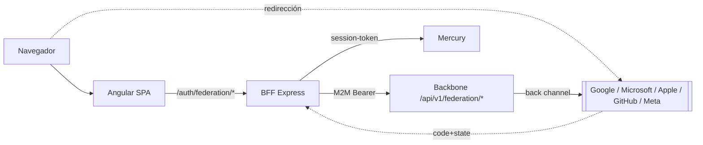
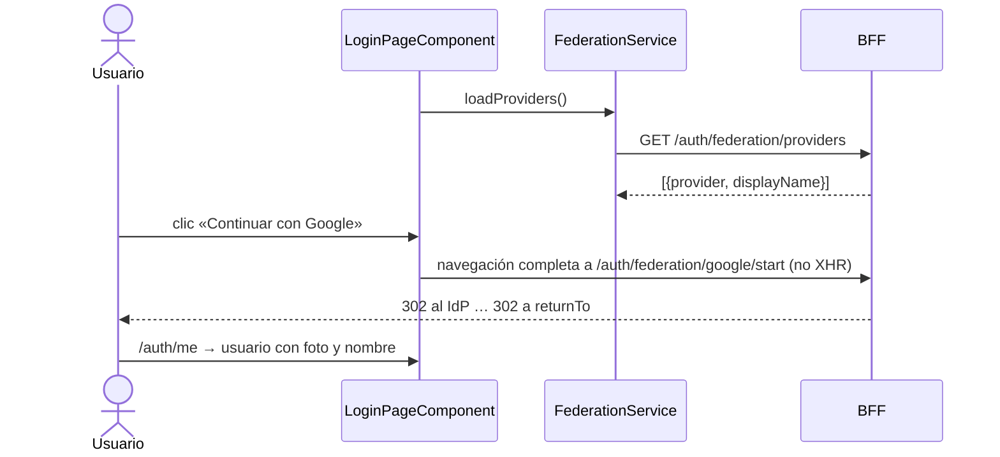

# Federación social en Iris (diseño propuesto)

> Estado: **decisiones confirmadas** (17 nov 2026); sin implementar. Proveedores: Google, Microsoft, Apple, GitHub y Meta. Solo entran usuarios que ya existen.
> Documentos hermanos en `backbone-rest`: `docs/requirements/social-federation.md` (requisitos), `docs/architecture/social-federation.md`
> (diseño de Backbone), `docs/plans/social-federation-implementation-plan.md` (plan por fases).

## 1. Qué cambia para Iris

Iris sigue hablando **solo con Backbone**. Backbone hace de *broker* de identidad: inicia el flujo OAuth 2.0 Authorization Code + PKCE
contra el proveedor (Google, Microsoft, Apple, GitHub o Meta), valida el ID token y devuelve el **mismo** par de tokens (`token`, `refreshToken` con `aid`) que el login por
contraseña. Por eso el BFF reutiliza `setSessionCookies`, `/auth/me`, el refresco y el logout sin cambios, y Mercury no se toca.

## 2. Rutas nuevas del BFF (`server/routes/federation.routes.js`)

| Ruta | Método | Qué hace |
|---|---|---|
| `/auth/federation/providers` | GET | Proveedores habilitados de la aplicación (para pintar los botones). Sin proveedores → sin botones |
| `/auth/federation/:provider/start?returnTo=` | GET | Valida `returnTo`, pide `authorize` a Backbone, guarda la cookie `fed_state` y redirige (302) al IdP |
| `/auth/federation/callback` | GET | Compara `state` con la cookie; llama a `callback` de Backbone; fija las cookies de sesión; redirige a `returnTo` |
| `/auth/federation/:provider/link` | POST | (con sesión + CSRF) inicia el enlace de una cuenta |
| `/auth/federation/identities` | GET | Lista de cuentas enlazadas del usuario |
| `/auth/federation/identities/:id` | DELETE | (CSRF) desenlaza; `409` si es el único medio de acceso |

Reglas del BFF:

- **`fed_state`**: `HttpOnly; Secure; SameSite=Lax; Path=/auth/federation; Max-Age=600`. Lax es necesario porque el IdP vuelve con un GET de nivel superior; Strict perdería la cookie. (Apple usa `form_post`: fase 3, ruta POST propia; GitHub y Meta usan el mismo flujo de este documento.)
- **`returnTo`**: solo rutas relativas del mismo origen (`/` + no `//`, sin esquema, sin `\`), con lista de permitidos; si no, `/dashboard`.
- Un `state` que no coincide **no llama a Backbone** y termina en `/login?error=expired`.
- Todas las respuestas llevan `Cache-Control: no-store`; los límites de tasa reutilizan `express-rate-limit` del login.
- Nunca se registran `code`, `state` ni tokens (máscara en `logger`).

### Mapa de errores → `/login?error=<código>`

| Origen | Código | Mensaje en pantalla |
|---|---|---|
| IdP `error=access_denied` | `denied` | Cancelaste el inicio de sesión |
| `state` inválido/expirado/reutilizado | `expired` | El inicio de sesión expiró; vuelve a intentarlo |
| ID token inválido (`401`) | `failed` | No pudimos verificar tu cuenta |
| `403 federation_not_registered` (Iris nunca crea usuarios) | `not_registered` | Tu cuenta no está registrada; pide acceso a un administrador |
| `403` correo no verificado / dominio | `not_allowed` | Esta cuenta no tiene permiso |
| `502/503` | `unavailable` | Servicio no disponible; usa tu contraseña |
| `429` | `rate_limited` | Demasiados intentos |

## 3. Frontend (Angular)

- `FederationService` (signals): proveedores, cuentas enlazadas, estados `loading|error`.
- `LoginPageComponent`: botones por proveedor (icono Lucide/SVG propio, texto traducible, `aria-label`), banner de error según `?error=`, deshabilitado mientras redirige.
- Página **Cuenta → Cuentas enlazadas**: listar, enlazar (POST con CSRF), desenlazar con confirmación.
- SSR: los botones se renderizan solo en el navegador (la navegación depende de `window.location`); el servidor no llama al IdP.
- `toUser()` pasa a leer `amr` y `picture` (ya soporta `email`/`avatarUrl`).

## 4. Configuración

| Variable | Valor por defecto | Nota |
|---|---|---|
| `FEDERATION_ENABLED` | `false` | Interruptor de funcionalidad (también oculta los botones) |
| `FEDERATION_RETURN_TO_ALLOWLIST` | `/dashboard` | Prefijos permitidos |
| `FEDERATION_CALLBACK_URL` | derivada de la URL pública | Debe registrarse **exacta** en Backbone y en el IdP, por entorno |

Los secretos del IdP **no** están en Iris: viven en Vault y los usa Backbone. CSP: sin nuevos `script-src`; `form-action` ya cubre las
redirecciones por navegación. Registrar `…/auth/federation/callback` por entorno (development, qa, production).

## 5. Pruebas (≥ 85 %)

| Nivel | Casos |
|---|---|
| BFF (Vitest + `harness.js`, Backbone simulado) | start redirige con cookie; callback feliz fija cookies; `state` ≠ cookie → sin llamada; `returnTo` malicioso (`//evil`, `https://evil`, `\\evil`) → `/dashboard`; cada código de error; CSRF en link/unlink; flag apagado → 404; no se filtran `code`/tokens en logs |
| Angular | login con/sin proveedores, banner por `?error=`, cuentas enlazadas (listar/enlazar/desenlazar/409), accesibilidad básica |
| Integración | BFF + Backbone con IdP simulado (MockServer): login, denegado, reintento del mismo `code` |

Se ejecutan **todas** las suites (`pnpm test:all`) antes de cada PR.

## 6. Dependencias y orden

1. Backbone Fase 0–1 (endpoints, flag apagado) — contrato fijo `/api/v1/federation/*`.
2. Iris Fase 2 (esta guía) con Backbone simulado, en paralelo al final de la Fase 1.
3. Habilitar en development → qa → producción (flag por entorno). Retroceso: `FEDERATION_ENABLED=false`.

## 7. Guía de usuario (resumen)

En la pantalla de inicio de sesión aparecerá **Continuar con Google / Microsoft / Apple / GitHub / Meta**. Tu cuenta debe existir ya en Iris (si no, pide acceso a
un administrador). Si el correo del proveedor está verificado y coincide, se enlaza la primera vez; con Meta (o correo sin verificar) enlaza la cuenta tú mismo en **Cuenta → Cuentas enlazadas**. En **Cuenta → Cuentas enlazadas** puedes enlazar o quitar proveedores; no puedes quitar el último medio de acceso. La
contraseña sigue funcionando. Se incorporará al manual del operador (`docs/user/manual-operador.md`) al implementarse.
