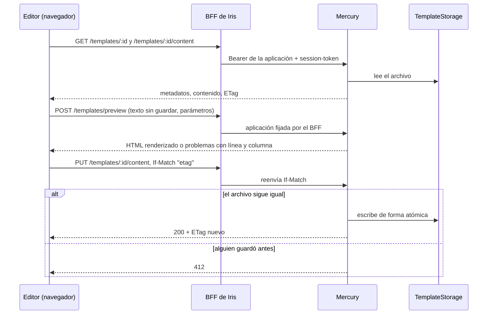

# Editor de plantillas

Iris crea, edita y desactiva las plantillas de mensajes de Mercury y escribe su contenido en HTML o Markdown con vista previa. Iris no guarda nada: el BFF reenvía a Mercury con las credenciales de la aplicación y la sesión de la persona. El contenido vive donde lo decide Mercury (`TemplateStorage`: carpeta local hoy, nube después); ver `docs/architecture/template-storage.md` y `docs/template-management-api.md` en Mercury.

## Rutas del BFF (`server/routes/templates.routes.js`)

| Método y ruta | Mercury | Notas |
|---|---|---|
| `GET /templates` | `GET /templates` | Solo `q`, `templateTypeId`, `severityTypeId`, `active`, `page`, `size`, `sort`; la aplicación la pone el BFF. |
| `POST /templates` | `POST /templates` | Solo `description`, `location`, `fileFormat`, `templateTypeId`, `severityTypeId`. `location` debe ser un nombre de archivo (`.ftl`, `.ftlh`, `.md`, `.html`); si no, 400 sin llamar a Mercury. |
| `GET/PUT/DELETE /templates/:id` | igual | `:id` debe ser UUID. DELETE desactiva (borrado lógico). |
| `GET /templates/:id/content` | igual | Devuelve el contenido y su `etag`. |
| `PUT /templates/:id/content` | igual | Pasa `If-Match` o `If-None-Match: *` y devuelve el `ETag`. Solo viaja `content`. |
| `POST /templates/preview` | `POST /templates/preview` | Solo `name`, `content`, `params`; la aplicación la pone el BFF. |
| `GET /templates/{types,severities,defined}` | listas de referencia | Ver `docs/technical/campaigns.md`. |

Escribir (`PUT`, `POST /preview`, `DELETE`) necesita `mercury:message:write` en `BACKBONE_CLIENT_SCOPES`, registrado antes en el cliente M2M de Backbone; la persona, además, el permiso `TEMPLATE_MANAGE` en la aplicación.

## Frontend

| Pieza | Ruta o archivo |
|---|---|
| Lista con búsqueda, filtros y paginación en el servidor | `/dashboard/templates` · `templates-page` |
| Crear y editar | `/dashboard/templates/new`, `/dashboard/templates/:id` · `template-editor-page` |
| Llamadas al BFF | `TemplatesService`, `ReferenceDataService` |
| Nombre de archivo, líneas, parámetros, documento de la vista previa | `features/dashboard/utils/template-input.ts` |
| Aviso al salir con cambios | `unsavedChangesGuard` (`canDeactivate`) y `beforeunload` |

### Cómo funciona el editor

- **Crear:** la descripción propone el nombre del archivo (`Código de verificación` → `codigo-de-verificacion.md`) hasta que la persona lo cambia; cambiar el formato cambia la extensión. Se hace `POST /templates` y luego `PUT .../content` con `If-None-Match: *`. Si lo segundo falla, la plantilla ya existe: se avisa y se abre para terminar.
- **Editar:** se guardan por separado los metadatos (si cambiaron) y el contenido (si cambió). El contenido se guarda con `If-Match` con la huella leída; la respuesta trae la nueva.
- **Conflictos:** un 412 muestra un aviso con **Recargar**, que descarta lo escrito y trae la versión de la otra persona.
- **Errores de sintaxis:** un 422 (al guardar) o `problems` de la vista previa (al escribir) se listan con línea y columna; **Ir a la línea** selecciona esa línea en el cuadro de texto.
- **Vista previa:** 500 ms después de la última tecla se pide `POST /templates/preview` con los parámetros de ejemplo. El resultado se muestra en un `iframe` con `sandbox=""` (sin scripts ni acceso al sitio) y un documento con una política CSP que bloquea todo salvo estilos propios, imágenes `https:` y `data:`. Los parámetros detectados se agregan solos a la lista de ejemplo.
- **Plantillas del sistema** (`zb_`, `sk_`, `iris_`, `ds_`): Mercury las marca `readOnly`; el editor las abre de solo lectura, con vista previa.
- **Sin editor de código externo:** el contenido se edita en un `<textarea>`; un editor con resaltado (CodeMirror) queda como mejora (ver `docs/analysis/editor-plantillas-y-campanas.md`).

## Pruebas

- BFF: `server/test/templates.spec.js` y `templates-off.spec.js` (Bearer y sesión, aplicación fijada, campos descartados, nombre de archivo, `If-Match`/`If-None-Match`/`ETag`, 412/422/428, 403 y 503).
- Frontend: especificaciones junto a cada página, servicio, guard y utilidad; Mercury se sustituye con `testing/templates.testing.ts`.
