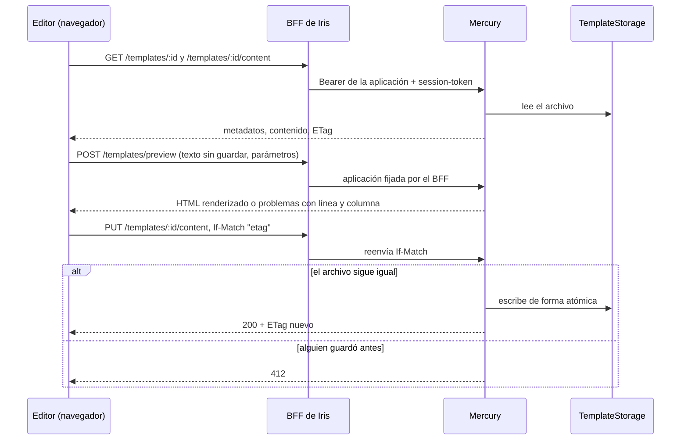
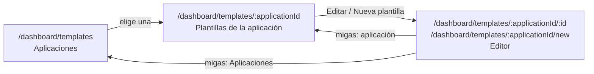
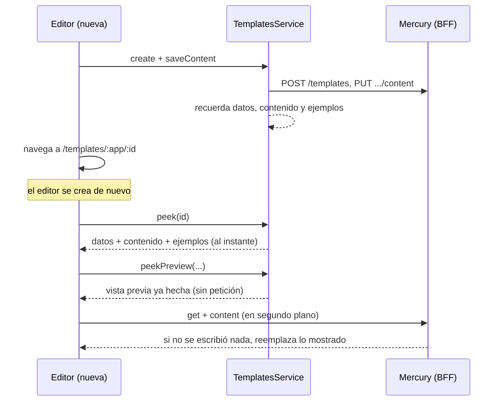
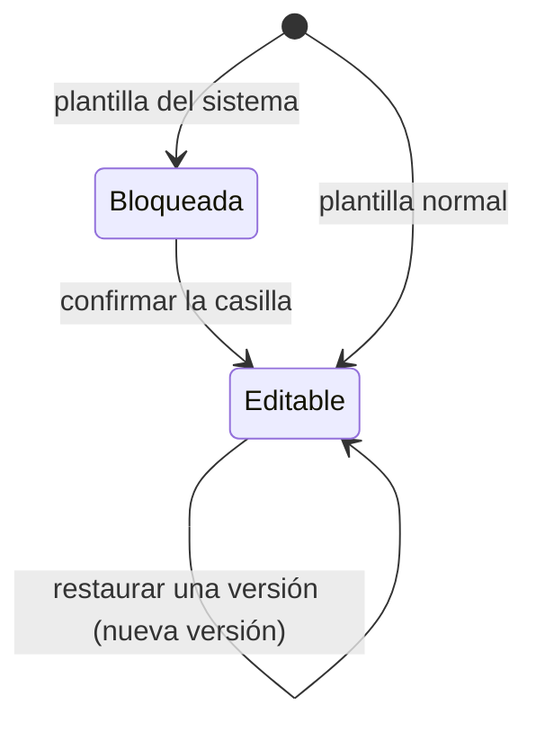

# Editor de plantillas

Iris crea, edita y desactiva las plantillas de mensajes de Mercury y escribe su contenido en HTML o Markdown con vista previa. Iris no guarda nada: el BFF reenvía a Mercury con las credenciales de la aplicación y la sesión de la persona. El contenido vive donde lo decide Mercury (`TemplateStorage`: carpeta local hoy, nube después); ver `docs/architecture/template-storage.md` y `docs/template-management-api.md` en Mercury.

## Rutas del BFF (`server/routes/templates.routes.js`)

| Método y ruta | Mercury | Notas |
|---|---|---|
| `GET /templates/applications` | `GET /applications` de **Backbone** | Las aplicaciones entre las que se elige. Lleva la sesión de la persona como `Authorization: Bearer` **y** `session-token`: los recursos de backbone-rest autentican solo el `Bearer`; sin él responde 401 y el navegador cierra la sesión. |
| `GET /templates/applications/:applicationId` | `GET /templates` | La aplicación sale de la URL (UUID) y se ignora la del navegador. Solo `q`, `templateTypeId`, `severityTypeId`, `active`, `page`, `size`, `sort`. Mercury comprueba `TEMPLATE_MANAGE` para esa aplicación (403 si no). No necesita `MONITORED_APPLICATION_ID`. |
| `POST /templates/applications/:applicationId` | `POST /templates` | Igual que `POST /templates`, con la aplicación de la URL. |
| `POST /templates/applications/:applicationId/preview` | `POST /templates/preview` | Igual que `/preview`, con la aplicación de la URL. |
| `GET /templates` | `GET /templates` | Ruta anterior, con la aplicación del BFF (`MONITORED_APPLICATION_ID`). Solo `q`, `templateTypeId`, `severityTypeId`, `active`, `page`, `size`, `sort`; la aplicación la pone el BFF. |
| `POST /templates` | `POST /templates` | Solo `description`, `location`, `fileFormat`, `templateTypeId`, `severityTypeId`. `location` debe ser un nombre de archivo (`.ftl`, `.ftlh`, `.md`, `.html`); si no, 400 sin llamar a Mercury. |
| `GET/PUT/DELETE /templates/:id` | igual | `:id` debe ser UUID. DELETE desactiva (borrado lógico). |
| `GET /templates/:id/content` | igual | Devuelve el contenido y su `etag`. |
| `PUT /templates/:id/content` | igual | Pasa `If-Match` o `If-None-Match: *` y devuelve el `ETag`. Solo viaja `content`; la única consulta que pasa es `confirmSystem=true\|false` (otro valor, 400). |
| `POST /templates/preview` | `POST /templates/preview` | Solo `name`, `content`, `params`; la aplicación la pone el BFF. |
| `GET /templates/:id/versions`, `GET /templates/:id/versions/:n` | igual | `:n` entero positivo (hasta 9 cifras); otro valor es 400 sin llamar a Mercury. |
| `POST /templates/:id/versions/:n/restore` | igual | Pasa `If-Match`. Guarda la versión antigua como una nueva. |
| `GET /templates/{types,severities,defined}` | listas de referencia | Ver `docs/technical/campaigns.md`. |

Escribir (`PUT`, `POST /preview`, `DELETE`) necesita `mercury:message:write` en `BACKBONE_CLIENT_SCOPES`, registrado antes en el cliente M2M de Backbone; la persona, además, el permiso `TEMPLATE_MANAGE` en la aplicación.

## Navegación por aplicación

Cada aplicación tiene sus propias plantillas (en Mercury, su carpeta del almacenamiento: `<prefijo>/<aplicación>/<archivo>`). Iris lo refleja en tres niveles, cada uno con su ruta:

- La lista de aplicaciones sale de Backbone (`GET /applications`), solo las activas, por nombre. Elegir una que la persona no puede gestionar muestra el aviso «No tienes permiso para administrar las plantillas» (Mercury responde 403).
- La aplicación viaja en la URL, nunca en el cuerpo: el BFF la valida como UUID y la pone en la llamada a Mercury. El editor la usa para crear, previsualizar y volver a la lista.
- `location` sigue siendo solo el nombre del archivo: Mercury añade la carpeta de la aplicación al leer y al guardar (`docs/tec/en/11-template-application-folders.md` en Mercury).

## Frontend

| Pieza | Ruta o archivo |
|---|---|
| Elegir la aplicación | `/dashboard/templates` · `template-applications-page` |
| Lista de la aplicación, con búsqueda, filtros y paginación en el servidor | `/dashboard/templates/:applicationId` · `templates-page` |
| Crear y editar | `/dashboard/templates/:applicationId/new`, `/dashboard/templates/:applicationId/:id` · `template-editor-page` |
| Llamadas al BFF | `TemplatesService`, `ReferenceDataService` |
| Nombre de archivo, líneas, parámetros, documento de la vista previa | `features/dashboard/utils/template-input.ts` |
| Diferencia entre dos textos | `features/dashboard/utils/text-diff.ts` |
| Aviso al salir con cambios | `unsavedChangesGuard` (`canDeactivate`) y `beforeunload` |

### Cómo funciona el editor

- **Crear:** la descripción propone el nombre del archivo (`Código de verificación` → `codigo-de-verificacion.md`) hasta que la persona lo cambia; cambiar el formato cambia la extensión. Se hace `POST /templates` y luego `PUT .../content` con `If-None-Match: *`. Si lo segundo falla, la plantilla ya existe: se avisa y se abre para terminar.
- **Asunto del correo:** el formulario tiene el campo **Asunto del correo** (opcional, hasta 500 caracteres; puede usar datos del mensaje como `${vc}`). Es el `subject` de la plantilla en Mercury (una por idioma): al crear se envía si se escribió, al editar solo si cambió, y vaciarlo lo quita. Mercury lo usa para los correos de la plantilla; así las aplicaciones (p. ej. ZeroBound) no lo llevan en su código. El BFF deja pasar `subject` en crear y editar.
- **Editar:** los metadatos (si cambiaron) y el contenido (si cambió) se guardan **a la vez** (`Promise.allSettled`): son independientes en Mercury, así que no se espera uno al otro. Lo que se guardó queda guardado aunque lo otro falle, y se avisa del error. El contenido se guarda con `If-Match` con la huella leída; la respuesta trae la nueva.
- **Conflictos:** un 412 muestra un aviso con **Recargar**, que descarta lo escrito y trae la versión de la otra persona.
- **Errores de sintaxis:** un 422 (al guardar) o `problems` de la vista previa (al escribir) se listan con línea y columna; **Ir a la línea** selecciona esa línea en el cuadro de texto.
- **Vista previa:** 350 ms después de la última tecla se pide `POST /templates/preview` con los parámetros de ejemplo. Mercury pone ese mismo HTML, sin envoltorio ni estilos añadidos, como cuerpo `text/html` UTF-8 del correo (`EmailServiceImpl`), así que la vista previa no añade estilos: lo que se ve es lo que se envía. El resultado se muestra en un `iframe` con `sandbox="allow-same-origin"` (sin scripts, formularios ni ventanas; `allow-same-origin` solo permite que la página lea el alto del correo) y un documento con una política CSP que bloquea todo salvo estilos propios, imágenes `https:` y `data:`, con `viewport` para el ancho de móvil. Los parámetros detectados se agregan solos a la lista de ejemplo. Además:
  - **Asunto:** se muestra encima del correo con los datos de ejemplo, como lo resuelve `SubjectRenderer` de Mercury para `${dato}` y `${dato!"respaldo"}` (`renderSubject`). Si usa un dato sin valor de ejemplo lo avisa (un envío real sin él se rechaza); si usa otras expresiones de FreeMarker las deja tal cual y lo marca como aproximado.
  - **Datos sin ejemplo:** si la plantilla usa datos que no tienen valor de ejemplo, un aviso los nombra: la vista previa los deja vacíos, pero un envío real sin ellos falla.
  - **Escritorio / Móvil:** el marco ocupa el ancho de la tarjeta o 375 px; su alto se ajusta al del correo (240–1400 px) al cargar, para verlo completo sin barra interna.
  - **Sin retrocesos:** cada petición lleva un número; una respuesta que llega después de otra más nueva se descarta. Con errores de sintaxis (o si la vista previa falla) se conserva la **última vista válida**, atenuada y con el aviso «se muestra la última versión válida», en vez de quedar en blanco.
- **Plantillas del sistema** (`zb_`, `sk_`, `iris_`, `ds_`): Mercury las marca `system`. El editor las abre **bloqueadas** con un aviso y una casilla de confirmación; al marcarla se desbloquea y el guardado (y la restauración) viaja con `confirmSystem=true`. Mercury conserva el original como versión `BASELINE`, así que siempre se puede volver a él.
- **Historial:** en una plantilla con archivo, **Ver historial** lista las versiones (`Guardado`, `Restauración`, `Original`). **Comparar** muestra la diferencia línea por línea entre esa versión y el texto del editor (`diffLines`, subsecuencia común más larga; por encima de 2000 líneas por lado se marca todo como cambiado para no bloquear el navegador). **Restaurar** pide confirmación, avisa si hay cambios sin guardar, envía `If-Match` con la huella actual y deja el editor con el contenido restaurado; un 412 muestra el aviso de conflicto.

### Carga al instante después de guardar

`TemplatesService` recuerda en memoria (solo mientras la pestaña está abierta) lo último que leyó o guardó: los datos y el contenido de cada plantilla, los parámetros de ejemplo que la persona escribió, cada búsqueda de la lista y las últimas 20 vistas previas (1 min). `ReferenceDataService` pide tipos y severidades una vez por sesión, y las aplicaciones también; si la primera petición falla, la siguiente vuelve a pedir.

- **Editor:** con `peek(id)` se dibuja sin el «Cargando plantilla…» y se confirma con el servidor en segundo plano. Si la persona ya escribió algo cuando llega la respuesta, no se pisa; si la huella cambió, se muestra el aviso de conflicto. Si el servidor no responde, se queda lo mostrado (el guardado sigue usando la huella, así que no se sobrescribe nada por error).
- **Lista:** `peekSearch` dibuja al instante la última respuesta de la misma búsqueda, con una barra fina de «actualizando» mientras llega la nueva; la primera vez muestra un esqueleto en vez de un texto. Editar una plantilla la cambia en las listas recordadas; crear o desactivar las olvida (la siguiente visita pregunta al servidor). La fila guardada en los últimos 2 min se resalta con **Recién guardada**. Cada fila muestra el formato (Markdown/HTML), el asunto si lo tiene y «hace N min» (la fecha completa en el `title`).
- **La memoria no sustituye al servidor:** cada página vuelve a pedir los datos siempre; se pierde al recargar la pestaña.

- **Sin editor de código externo:** el contenido se edita en un `<textarea>`; un editor con resaltado (CodeMirror) queda como mejora (ver `docs/analysis/editor-plantillas-y-campanas.md`).

## Pruebas

- BFF: `server/test/templates.spec.js` y `templates-off.spec.js` (Bearer y sesión, aplicación fijada, campos descartados, nombre de archivo, `If-Match`/`If-None-Match`/`ETag`, 412/422/428, 403 y 503).
- Frontend: especificaciones junto a cada página, servicio, guard y utilidad; Mercury se sustituye con `testing/templates.testing.ts` (que incluye `peek`, `peekSearch`, `peekPreview`, `rememberSamples` y `recentlySaved`). La memoria de `TemplatesService` y de `ReferenceDataService` se prueba con `HttpTestingController`; el editor prueba la carga desde memoria, la vista previa que no retrocede, la última vista válida, el asunto, el ancho de móvil y el guardado en paralelo.
