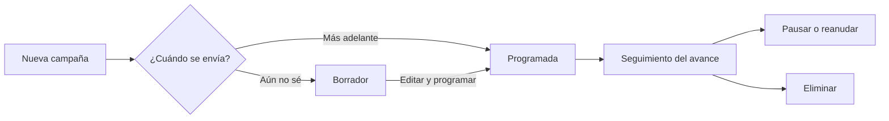

# Manual del operador de Iris

> Borrador. Cada sección la completa la tarea indicada; la versión final se consolida en F5-05.

Iris muestra en tiempo casi real cómo se están enviando los mensajes SMS, WhatsApp y Email: cuántos se enviaron, cuántos se entregaron, cuánto tardan y qué servicios tienen problemas.

## 1. Iniciar sesión
_Pendiente — F2-04._ Usuario y contraseña, mensajes de error y qué hacer.

## 1 bis. Crear una cuenta
En la pantalla de inicio de sesión pulsa **Crear una cuenta** y completa el formulario. Te enviaremos un código de 6 dígitos al correo, válido por 15 minutos; escríbelo para activar la cuenta. Si no te llega, pulsa **Enviar otro código**. Tienes 3 intentos por código.

## 2. Sesión expirada
_Pendiente — F2-06._

## 3. Cerrar sesión
_Pendiente — F2-07._

## 4. Página principal
Los indicadores salen de las campañas de Mercury. Si aún no hay datos, la página lo indica en lugar de mostrar cifras.

| Indicador | Qué mide | Cómo se calcula |
|---|---|---|
| Mensajes totales | Destinatarios de las campañas | Suma de todas las campañas |
| Tasa de entrega | Mensajes que llegaron | Entregados ÷ (entregados + fallidos) |
| Fallidos | Mensajes que no se entregaron | Suma de todas las campañas |
| Pendientes | Mensajes en curso | Suma de todas las campañas |

La tendencia compara con la lectura anterior, por eso no aparece en la primera.

## 5. Buscar campañas
En **Campañas** busca por nombre y filtra por canal y estado. Una campaña está **En curso** si le quedan mensajes por enviar, **Entregada** si terminó con entregas y **Fallida** si terminó sin ninguna.

## 6. Estado de servicios
Iris comprueba Mercury y Backbone en cada actualización y muestra la latencia medida. *Operational*: responde bien. *Degraded*: responde, pero tarda más de un segundo. *Down*: no responde o informa un fallo.

## 7. Actualización automática
Los datos se actualizan cada 30 segundos mientras la pestaña está visible. El botón de actualizar lo hace al momento.

## 8. Qué hacer si no cargan los datos
Un aviso indica el problema. Si dice que no se pudieron actualizar, Iris reintenta sola y conserva la última lectura. Si dice que Mercury no entregó las campañas, revisa el estado de los servicios en la misma página.

## 8 bis. Clientes de login (administración)

**Dashboard → Login clients.** Aquí se gestionan los servicios backend (smartkin-backend, zerobound-rest…) que pueden pedir un token a Mercury. El **alias es el nombre del servicio**, no el de una persona.

- **Nuevo cliente:** alias (letras, números, `.`, `_`, `-`), descripción opcional y contraseña opcional (12 a 72 caracteres ASCII, sin espacios). Si la dejas vacía, Mercury genera una segura.
- **La contraseña generada se muestra una sola vez.** Cópiala y configúrala en el servicio (smartkin-backend: `MERCURY_LOGIN_ALIAS` y `MERCURY_LOGIN_PASSWORD` en su Vault). Mercury guarda solo un hash: si la pierdes, rota la contraseña.
- **Rotar contraseña:** genera una nueva, la anterior deja de valer y el cliente se reactiva. Hay que entregar la nueva al servicio.
- **Desactivar / Activar:** apaga o enciende el servicio sin perder el registro. Es la forma correcta de impedirle el acceso.
- **Eliminar:** borra el registro. Si el alias sigue en la configuración estática de Mercury podrá iniciar sesión por ahí.
- Cada acción pide confirmación. Si ves «No tienes permiso…», falta el permiso `LOGIN_CLIENT_MANAGE` en Backbone para tu usuario en la aplicación de Iris (y que Mercury tenga `LOGIN_CLIENTS_ADMIN_APPLICATION_ID`).

## 9. Preferencias
_Pendiente — F5-04._ Tema claro u oscuro.

## 10. Preguntas frecuentes
_Pendiente — F5-06 (a partir de la UAT)._

## Glosario
_Pendiente — F5-05._

## Campañas

En **Campañas** (menú lateral) ves las campañas que has creado, con su canal, su estado y cuántos mensajes se han entregado o han fallado.

### Crear una campaña

1. Pulsa **Nueva campaña**.
2. Escribe el **nombre** y elige el **canal** (correo, Telegram…).
3. Indica el **id de la plantilla** que se enviará.
4. Pega los **destinatarios**, una persona por línea (`correo,nombre`), o pulsa **Importar CSV**. Los repetidos se descartan solos y el contador te dice cuántos quedan.
5. Si la plantilla usa datos variables, escríbelos en **Parámetros** (`nombre=Ana`, uno por línea).
6. Elige **Borrador** o **Programada**. Una campaña programada necesita fecha y hora futuras.
7. Pulsa **Crear campaña**.

### Seguir, pausar y eliminar

- La lista muestra una barra con el avance de cada campaña y puedes filtrar por nombre, estado o canal.
- **Ver** abre el detalle con enviados, entregados, fallidos y pendientes; se actualiza solo cada 15 segundos.
- **Pausar** detiene los envíos que aún no han salido (lo ya enviado no se puede detener). **Reanudar** los retoma.
- **Eliminar** pide confirmación y no se puede deshacer.
- **Editar** solo está disponible mientras la campaña es borrador o está programada. Si dejas vacío el cuadro de destinatarios se conservan los actuales.

### Mensajes que puedes ver

| Mensaje | Qué significa | Qué hacer |
|---|---|---|
| «No puedes … esta campaña: solo quien la creó puede hacerlo…» | Otra persona creó la campaña, o a Iris le falta permiso de escritura en Mercury. | Pide a quien la creó que lo haga, o avisa al administrador. |
| «Mercury rechazó los datos…» | La plantilla, el canal o los destinatarios no son válidos. | Revisa el id de la plantilla y que el canal esté habilitado. |
| «La campaña ya no existe» | Alguien la eliminó. | Actualiza la lista. |
| «La gestión de campañas no está configurada» | Falta configurar la aplicación en Iris. | Avisa al administrador. |
| «No tienes permiso para ver las campañas» | Tu cuenta no puede leer las campañas. | Avisa al administrador. |
